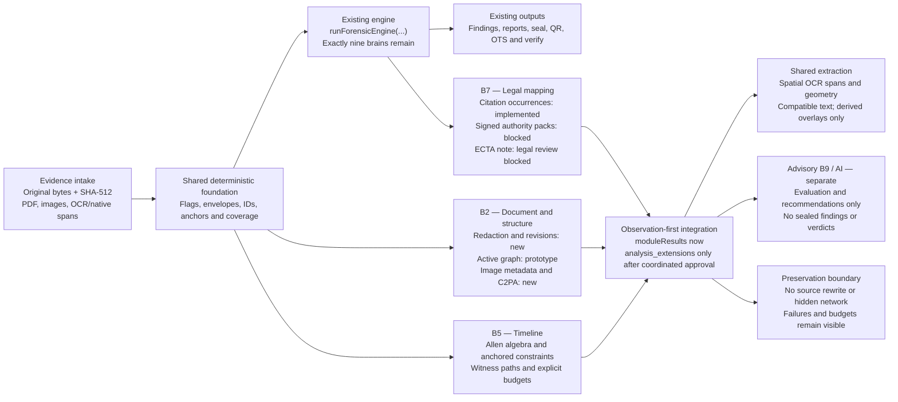
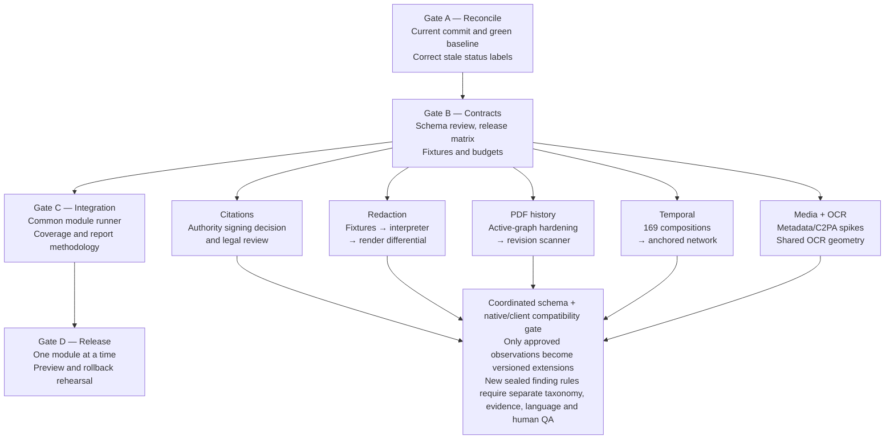

# Verum Omnis Forensic Engine Enhancement Implementation Plan

**Repository-grounded delivery design — architecture, work packages, security, tests, rollout and acceptance**

> **Purpose**
>
> A dependency-led engineering plan for completing the remaining Verum Omnis analysis options without weakening the deterministic finding core, evidence anchors, original-byte preservation, advisory-AI boundary, sealing behaviour or public verification contracts.

Architecture • Work packages • Security • Tests • Rollout • Acceptance

| **Document control**  | **Value**                                                                                       |
|-----------------------|-------------------------------------------------------------------------------------------------|
| Document version      | 1.0                                                                                             |
| Date                  | 20 November 2026                                                                                |
| Repository            | liamhigh/webdocsol                                                                              |
| Reviewed commit       | 48836bc7c2f245b00e181d66b539c199d6fcaf2d                                                        |
| Current engine        | 5.7.2-web                                                                                       |
| Current Findings JSON | 1.11.0                                                                                          |
| Planning basis        | Current source, current tests, the 15 November 2026 enhancement brief and contributor rules     |
| Scheduling basis      | Dependency order only; no invented delivery dates, effort estimates or unsupported capabilities |

## Markdown publication and AI quick-start

| **Publication field** | **Value** |
|---|---|
| Living implementation status | [`ENHANCEMENT-PLAN.md`](./ENHANCEMENT-PLAN.md) — check this before treating any planned item as current work |
| Court-record and legal-status boundary | [`LEGAL-VALIDATION.md`](./LEGAL-VALIDATION.md) — filing and procedural history are not judicial endorsement |
| Binding contributor rules | [`AGENTS.md`](./AGENTS.md) |
| Source document | `Verum Omnis Forensic Engine Enhancement Implementation Plan-sealed.pdf`, supplied for this conversion |
| Source-document seal identifier | `VO-967D928C4989` |
| Uploaded source-file SHA-512 | `71a6c8a86f9a8962bd35489a9b91ec349a0c4c75fd07f0f648de66416f1998edf6694907557dd4c67945811df64f045cbd1acd912425fede32cc52ba21d83938` |
| Markdown integrity status | This file is a readable counterpart of the source document; it is **not itself cryptographically sealed**, and conversion did not independently verify an OpenTimestamps receipt |

**For Copilot, Claude and other coding agents:** read the living status record and sections 1–3 before changing code. Then use the relevant module section, Appendix A and the acceptance matrices. Implement one independently gated slice at a time. Do not infer that a feature is shipped merely because it is designed here.

The reviewed baseline is commit `48836bc7c2f245b00e181d66b539c199d6fcaf2d`: engine `5.7.2-web`, production Findings JSON `1.11.0`, exactly nine analytical brains, and eight default-off enhancement flags. Only `citations` and the bounded `pdfGraph` prototype have shipped implementations at that baseline; the other flags fail closed. Signed authority packs and the ECTA note remain externally blocked. The extension contract remains proposal `0.1.0`; do not assume production Findings JSON `1.12.0`.

Preserve original evidence bytes, deterministic finding authority, complete evidence anchors, stable ordering, old-seal verification and the separation of advisory AI from sealed findings. New modules begin as observations only. No neural/top-k prefilter, hidden network dependency, wall-clock input, randomness, locale-dependent canonical result or telemetry belongs in pure analysis. A documentation update does not enable a module, approve a schema, discharge legal review or deploy the website.

## Contents

1. [Executive Implementation Decision](#executive-implementation-decision)
2. [1. Verified Baseline, Scope and Status Reconciliation](#section-1)
3. [2. Target Architecture and Constitutional Invariants](#section-2)
4. [3. Programme Gates and Shared Prerequisites](#section-3)
5. [4. Legal Citation and Authority Completion](#section-4)
6. [5. Ineffective-Redaction Inspection](#section-5)
7. [6. Active-Graph Hardening and Revision History](#section-6)
8. [7. Allen Temporal Constraint Reasoning](#section-7)
9. [8. Image Metadata](#section-8)
10. [9. Read-Only C2PA / Content Credentials](#section-9)
11. [10. Spatial OCR and Native Coordination](#section-10)
12. [11. Integration, Reporting and Schema Change Control](#section-11)
13. [12. Test and Assurance Plan](#section-12)
14. [13. Security, Privacy and Resource Governance](#section-13)
15. [14. Delivery Sequence, Rollout and Rollback](#section-14)
16. [15. Decision Register and Completion Criteria](#section-15)
17. [Appendix A. File-Level Implementation Map](#appendix-a)
18. [Appendix B. Module Acceptance Matrix](#appendix-b)
19. [Appendix C. Verification Commands and Review Record](#appendix-c)

# Executive Implementation Decision

> **Decision**
>
> Extend the existing engine through small, independently flag-gated modules. Do not rebuild the engine, add a tenth brain, place AI inside the sealed finding path, or combine every enhancement into one large rewrite.

The current repository already has the deterministic foundation needed for this programme: explicit default-off module flags, fail-closed activation, canonical module envelopes, deterministic identifiers and ordering, text and structural anchors, OCR and pair-finding contracts, and proposed cross-client extension fixtures. Citations and a bounded active-PDF-graph prototype are implemented; the other six flags deliberately reject activation.[^1][^2][^3]

The verified assurance baseline at the reviewed commit is 65 passing registered Node suites, a passing syntax-check command, and 12 passing browser tests across Chromium, Firefox and WebKit. The browser tests cover boot, offline egress controls, deterministic analysis with new flags off, and synthetic seal/verify flow. These results establish a working baseline, not proof that the unimplemented modules work.[^4][^5]

## Recommended delivery order

**1.** Reconcile status documentation and freeze the current green baseline. Treat merged work as merged, prototype work as prototype, and external approvals as external gates.

**2.** Complete the shared release controls: cross-client schema review, a version compatibility matrix, dependency admission records, common budget/failure conventions and observation-coverage reporting.

**3.** Complete citation authority work only when signing and legal-review blockers are resolved. In parallel, build redaction inspection, revision scanning and pure Allen algebra as separate flagged slices.

**4.** Run image-metadata and C2PA dependency/browser spikes before admitting production artifacts. Build spatial OCR geometry as a shared contract before changing website or native extraction.

**5.** Promote observations to sealed findings only through separately approved taxonomy, schema, evidence, report-language and human-QA changes. Enable modules by explicit versioned configuration after preview and rollback rehearsal.

## Highest-priority engineering outcomes

| **Priority** | **Outcome**                                                     | **Why it comes first**                                                                                                        |
|--------------|-----------------------------------------------------------------|-------------------------------------------------------------------------------------------------------------------------------|
| P0           | Truthful current-state record and unchanged flags-off behaviour | Every later regression comparison depends on a stable, correctly labelled baseline.                                           |
| P0           | Cross-client extension and replay contract                      | Module output must remain readable and verifiable across website, 1verum, firebase and relevant Android reference behaviour.  |
| P1           | Production redaction inspection                                 | Closes a high-value structural-evidence gap, but requires difficult geometry, ordering and privacy controls.                  |
| P1           | Incremental-revision scanner                                    | The active-graph prototype explicitly does not inspect revision history; QPDF writing is not a substitute.                    |
| P1           | Pure Allen algebra and anchored temporal constraints            | Adds multi-hop temporal inconsistency detection without replacing existing date detectors or overclaiming global consistency. |
| P2           | Signed authority packs and ECTA context                         | Valuable but externally blocked by coordinated key rotation and qualified legal review respectively.                          |
| P2           | Image metadata, C2PA and spatial OCR                            | Require dependency, device, coordinate, privacy and cross-client proof before production admission.                           |

## Programme limits

-   No calendar commitments or effort estimates are inferred from repository history. Work proceeds by acceptance gates.

-   No new contradiction type, detector identifier, Findings JSON version or report claim is pre-approved by this plan.

-   No real-matter confidential report material is to be copied into public fixtures, tests, issues, examples or generated documentation.

-   No source evidence may be rewritten by QPDF, a PDF writer, an OCR overlay, a metadata writer or a C2PA writer.

-   No missing metadata, absent credential, parser failure, incremental update or temporal nonempty result may be described as automatic proof of fraud, intent, authorship or global consistency.

# 1. Verified Baseline, Scope and Status Reconciliation

## 1.1 Source baseline and verification record

This plan is anchored to liamhigh/webdocsol commit 48836bc7c2f245b00e181d66b539c199d6fcaf2d, whose subject is “Phase 4 PR 4.1: bounded QPDF-WASM active-graph prototype (#316)”. The engine is 5.7.2-web, Findings JSON is 1.11.0, the sealing standard is VO-DSS-1.2 and the site package is webdocsol 1.2.5.[^6][^7]

| **Assurance check**                    | **Observed result at the reviewed commit** | **Interpretation**                                                                                                         |
|----------------------------------------|--------------------------------------------|----------------------------------------------------------------------------------------------------------------------------|
| node tests/run-all.js                  | RESULT: all 65 suites GREEN                | Current registered Node regression baseline passes.                                                                        |
| npm run check                          | Passed                                     | All currently registered production JavaScript syntax checks pass.                                                         |
| Playwright: Chromium, Firefox, WebKit  | 12 passed                                  | Four tests per browser pass: page boot/layout, offline guard, deterministic flags-off analysis, and synthetic seal/verify. |
| git diff --check                       | No whitespace errors reported              | Review worktree passed the repository’s requested diff check.                                                              |
| Repository modifications for this plan | None                                       | Review and test execution only; no source changes, pushes, merges or deployments.                                          |

The local browser launcher initially lacked the pinned Playwright browser binaries. Installing the exact binaries selected by the locked development dependency resolved that environment prerequisite; the subsequent 12-test run passed. The failed launch attempts were not application assertion failures and are not counted as product regressions.

## 1.2 Current functional inventory

The engine’s existing detector, report, OCR, sealing and verification behaviour is outside the rewrite scope. The current report constants describe 61 main-run detectors across 61 contradiction types and 17 serial-pattern definitions. The registry additionally retains D37 as a separate catch-all and D10A as inactive. New modules must not disturb those semantics incidentally.[^8][^9]

| **Capability**                  | **Verified current state**                                                                                                               | **Planning consequence**                                                                   |
|---------------------------------|------------------------------------------------------------------------------------------------------------------------------------------|--------------------------------------------------------------------------------------------|
| Shared analysis configuration   | Implemented. Eight flags default false; only citations and pdfGraph are listed as implemented.                                           | Retain fail-closed validation; add each module separately.                                 |
| Shared deterministic contracts  | Implemented. Envelopes, statuses, canonical serialization, stable IDs/order, UTF-16, structural/OCR/pair anchors and replay tests exist. | Reuse rather than creating parallel result formats.                                        |
| B9 evaluation                   | Implemented as development/CI-only metrics and ContractNLI/ContraDoc adapters.                                                           | Do not expose evaluation scores as user findings or production confidence.                 |
| Citation occurrence core        | Implemented behind citations flag; ZA pack; observations only; findings always empty.                                                    | Authority verification and legal context are separate unfinished work.                     |
| Signed authority packs          | Not implemented; blocked by deferred coordinated key rotation.                                                                           | Resolve trust/key governance before distribution code is enabled.                          |
| ECTA legal-context note         | Not implemented; blocked on qualified legal review.                                                                                      | Engineering may prepare versioned placement, not legal conclusions.                        |
| Redaction inspection            | Only synthetic test fixtures and fail-closed configuration exist.                                                                        | Build the production interpreter and geometry/render pipeline.                             |
| Active PDF graph                | Bounded QPDF-WASM prototype, default-off, observations only, active graph only.                                                          | Harden and test the enabled path; do not call it revision forensics.                       |
| Incremental revisions           | Not started.                                                                                                                             | Implement original-byte startxref//Prev scanner separately.                                |
| Allen temporal algebra          | Not started.                                                                                                                             | Build pure algebra, independently verify all 169 compositions, then add anchored networks. |
| Image metadata                  | Not started.                                                                                                                             | Run pinned exifr adapter spike; preserve raw values and sensitive-data defaults.           |
| C2PA                            | Not started.                                                                                                                             | Run current official SDK/WASM spike; read-only, offline-first, trust-separated.            |
| Spatial OCR/native coordination | Not started in this repository.                                                                                                          | Create shared span and transform contract before web/native integration.                   |
| Findings extension              | Proposal version 0.1.0 exists; explicitly not approved for production; next version is null.                                             | Do not write analysis_extensions into production Findings JSON yet.                        |

The configuration and current module attachments support this inventory: enabling an unimplemented module is rejected, while citations and pdfGraph attach separate envelopes under result.moduleResults. They do not silently join the detector findings array.[^10][^11][^12]

## 1.3 Documentation drift to correct before implementation

ENHANCEMENT-PLAN.md is valuable as a rule and blocker record, but several labels reflect the earlier pull-request stack rather than current main. It labels \#308–#314 and \#316 open even though their code is present in the reviewed main history. The older enhancement brief also begins from a 55-suite baseline; the current registered baseline is 65 suites.[^13][^14][^15]

| **Drift**                              | **Required correction**                                                                                                             | **Acceptance evidence**                                                                                  |
|----------------------------------------|-------------------------------------------------------------------------------------------------------------------------------------|----------------------------------------------------------------------------------------------------------|
| Merged slices labelled open            | Mark Phase 0, Phase 1, PR 2.1/2.2, Phase 3 fixtures and PR 4.1 prototype as present in main, while retaining prototype limitations. | Status record matches exact commit and merge history; documentation-consistency suite updated and green. |
| 55-suite historical baseline           | Keep 55 as the 15 November historical figure; use 65 for the current baseline and increment only when new suites are registered.    | tests/run-all.js, tests/README.md and relevant documentation counts agree.                               |
| External plan described as uncommitted | Recognise the root PDF as present at this commit and distinguish its older design baseline from current implementation.             | No stale statement remains in the active status record.                                                  |
| Schema proposal ambiguity              | State that proposal 0.1.0 exists but has not received production approval and assigns no next version.                              | Proposal, test documentation and release matrix use the same wording.                                    |
| Active-graph acceptance ambiguity      | Call it a bounded feasibility prototype, not full revision analysis or proof of authenticity.                                       | Enabled-path limitations appear in methodology, tests and rollout record.                                |

## 1.4 Scope boundaries

**In scope:** remaining citation authority/legal context; redaction inspection; active-graph production hardening; revision history; temporal algebra; image metadata; read-only C2PA; spatial OCR; shared integration, testing, security, rollout and rollback.

**Out of scope:** a new engine architecture, a tenth brain, neural prefiltering of the sealed corpus, an AI-generated finding path, a C2PA writer, a server-side document-processing service, automatic legal admissibility claims, and unilateral changes to VO-DSS, OTS, QR, manifest or verification behaviour.

**Separate open architecture work:** the documented VO-SEAL2 self-referential integrity limitation, D16 production reachability/ soundness, historical confidential-material remediation and live dashboard configuration are not solved by this enhancement programme. They must remain visible in their own governance tracks rather than being hidden by new features.

**External-repository limit:** native Android/iOS file paths and client behaviour are proposed coordination work, not verified current files in webdocsol. Native implementation requires separate repository audits and owner review.

# 2. Target Architecture and Constitutional Invariants

## 2.1 Module placement

The target design maps new structural, media and provenance inspection into B2, temporal constraint reasoning into B5, and citations/authority context into B7. Spatial OCR supplements shared extraction. Evaluation remains within B9. Exactly nine analytical brains remain; no new structural, spatial or evaluation brain is introduced.[^16][^17]

*Figure 1. Target architecture. New modules extend the existing brains and return observation envelopes first. Advisory B9/AI remains separate from sealed finding authority. Release control is default-off flags → synthetic preview → explicit opt-in → coordinated clients → versioned default enablement.*

| **Architecture zone**          | **Current anchor**                                       | **Planned extension**                                                                                      | **Authority boundary**                                                                              |
|--------------------------------|----------------------------------------------------------|------------------------------------------------------------------------------------------------------------|-----------------------------------------------------------------------------------------------------|
| Shared configuration/contracts | analysis-config.js; analysis-contracts.js                | New flags admitted one at a time; shared budgets, geometry and dependency metadata where genuinely common. | No environment-dependent state or hidden network input.                                             |
| Extraction                     | Existing PDF.js/Tesseract rescue and page texts          | ocr-spans.js and parallel structured span output.                                                          | Existing text contract remains until consumers explicitly support structured output.                |
| B2 — Document                  | voDigitalForensicsScan and PDF inspection                | Redaction, active graph, revisions, image metadata and C2PA.                                               | Measured structure/provenance observations; no automatic intent conclusion.                         |
| B5 — Timeline                  | Existing dates, timeline and temporal detectors          | allen-algebra.js and temporal-constraints.js.                                                              | Only supplied-constraint inconsistency; no global consistency or fabrication claim.                 |
| B7 — Legal mapping             | Current legal extraction plus citation occurrence module | Signed authority matching and reviewed jurisdiction context.                                               | Registry identity is not semantic legal support or a legal verdict.                                 |
| B9 — R&D                       | Development-only evaluation harness                      | Additional differential and algorithm oracles as needed.                                                   | No sealed findings, verdicts or production confidence scores.                                       |
| Reports/seal/verify            | Current builders and VO-DSS flow                         | Methodology coverage and approved additive extensions only.                                                | Original bytes, OTS delivered-byte digest, QR/manifest and old-seal verification remain compatible. |

## 2.2 Non-negotiable deterministic contract

Every module returns the common envelope even when input is not applicable or analysis fails. Allowed statuses are completed, completed_with_failures, not_applicable, unsupported, failed and budget_exceeded. Canonical analysis excludes wall-clock reads, randomness, network state, locale-dependent collation, telemetry and browser-only dependencies from the pure contract.[^18][^19]

| **Envelope element**       | **Required implementation behaviour**                                                                                                           |
|----------------------------|-------------------------------------------------------------------------------------------------------------------------------------------------|
| Identity                   | module_id, module_version and implementation_digest identify the exact algorithm/configuration lineage.                                         |
| Input and time             | input_sha512 identifies the contracted input; reference_time is caller-supplied or null, never read from the wall clock.                        |
| Configuration/dependencies | Record the selected flag, ruleset/pack/trust configuration and dependency versions needed for replay.                                           |
| Coverage                   | Account for every unit as processed, skipped with justification or failed. A cap never turns partial output into complete output.               |
| Observations/findings      | Observations carry measured facts and anchors. findings remains empty until a separate approved rule integrates through existing finding gates. |
| Warnings/failure           | Name unsupported features, parser differentials, budgets and exact failure codes. Failure never means “no contradiction.”                       |
| Ordering/IDs               | Sort by stable anchor, offset, rule and ID keys. Generate deterministic IDs from module identity, input hash, rule and anchors.                 |
| Performance data           | Keep elapsed time, memory peaks and device diagnostics in a separate development sidecar, never canonical sealed output.                        |

## 2.3 Evidence and geometry contract

-   Text offsets are UTF-16 code units in page-text-v1. Test surrogate pairs and combining characters; do not substitute Unicode code-point or UTF-8 byte offsets.

-   Retain exact quote, complete source-page context and existing page-anchor backfilling. Geometry supplements rather than replaces the quotation.

-   Non-text structural observations require complete structural evidence: artifact hash, byte range and object/generation identity, plus revision/operator/stream identifiers where relevant.

-   Pair findings require exactly two distinct complete source anchors and a rule-specific incompatibility explanation. No orphan pair members or duplicate use of one location as both sides.

-   Name every coordinate space. PDF user space generally uses bottom-left coordinates; image views and canvases commonly use top-left; Apple Vision normalized boxes use lower-left; ML Kit supplies pixel rectangles/corner points.

-   Perspective correction uses a projective 3×3 homography with explicit multiplication order and inverse mapping. Reject non-finite, singular, collinear or degenerate transformations.

## 2.4 Observation-to-finding promotion gate

The initial release of each new module is observations-only. A later finding requires a separately reviewed deterministic rule, complete evidence anchors, context and false-positive checks, common finding normalization, approved taxonomy identifiers, schema coordination, report-language tests and human review. No module may append ad hoc findings after those gates.[^20][^21][^22]

| **Gate**               | **Question that must be answered yes**                                                                      | **Evidence retained**                                                                                    |
|------------------------|-------------------------------------------------------------------------------------------------------------|----------------------------------------------------------------------------------------------------------|
| Measured fact          | Does the rule state only what the bytes, text, metadata or constraints establish?                           | Rule specification, raw/parsed values and counterexamples.                                               |
| Evidence               | Can every element be reproduced from the original source and complete anchors?                              | Quotes/context or structural records; both sides for pair findings.                                      |
| Context                | Do ordinary workflows, secondary sources, self-seals, OCR and ambiguity guards suppress unsupported claims? | Positive, negative, ambiguous and real-matter regression results without exposing confidential fixtures. |
| Taxonomy/schema        | Have CT/detector identifiers and additive output fields been approved by the responsible surfaces?          | One coordinated taxonomy/schema change with agreed versions.                                             |
| Language               | Does the narrative avoid intent, guilt, authorship, admissibility and unsupported certainty?                | Narrative tests and qualified human/legal review where applicable.                                       |
| Compatibility/rollback | Do old seals still verify and can the new rule be disabled without altering history?                        | Cross-client fixtures, old-seal verification and rollback rehearsal.                                     |

# 3. Programme Gates and Shared Prerequisites

*Figure 2. Dependency-led delivery. Independent modules may proceed in parallel only after the shared contract gate; every release remains separately reversible. Historical reports and seals are never rewritten; corrected analysis creates a new sealed output.*

## 3.1 Gate A — Reconcile and freeze the baseline

| **Field**     | **WP-A1: current-state reconciliation**                                                                                                                         |
|---------------|-----------------------------------------------------------------------------------------------------------------------------------------------------------------|
| Objective     | Make the active status record, test counts, module states and source baseline agree without changing detector behaviour.                                        |
| Modify        | ENHANCEMENT-PLAN.md and only those version/count references that are demonstrably stale; update documentation tests where their expected current values change. |
| Do not modify | Detector code, report language, Findings JSON, seal format, historical outputs or live deployment configuration.                                                |
| Tests         | node tests/run-all.js; npm run check; git diff --check; documentation-consistency and inline-source checks.                                                     |
| Acceptance    | All 65 current suites remain green; current merged/prototype/blocked/not-started states match source and history; no product output changes.                    |
| Rollback      | Revert documentation-only change; no data migration or seal compatibility impact.                                                                               |

## 3.2 Gate B — Contracts, schema and dependency governance

A proposed analysis_extensions object already exists as version 0.1.0 with next_production_version set to null. It requires review in 1verum and firebase and relevant Android reference behaviour in cursorfu. Production buildFindingsJson must remain at 1.11.0 until coordinated approval records the actual next version; 1.12.0 must not be assumed.[^23][^24][^25]

**1.** Create a release-compatibility matrix covering website, 1verum, firebase, cursorfu reference behaviour, Findings JSON base/extension versions, VO-DSS version, authority-pack format, trust configuration and verification compatibility.

**2.** Turn the proposed extension into versioned golden fixtures for every enabled module. Include old-producer/new-reader, new-producer/old-reader, unknown module, unknown extension preservation, duplicate retention, optional geometry and stable ordering cases.

**3.** Record external review evidence and the approved additive version before changing buildFindingsJson. If approval is not obtained, keep observations in result.moduleResults and development/preview output only.

**4.** Adopt a dependency admission record for each proposed library: exact package/revision, artifact digest, license, upstream source, maintenance review, transitive/runtime requirements, local patches, browser/WASM limits and expected network behaviour.

**5.** Vendor production browser artifacts under versioned vendor/ paths with license notices. Keep development evaluators and neural packages outside deployable static assets. Do not introduce a production bundler as a side effect.

**6.** Define shared budget and failure naming conventions without forcing one numerical limit onto dissimilar modules. Establish numerical budgets from measured safe operation on representative synthetic inputs and devices.

| **Deliverable**     | **Proposed location**                                                                             | **Gate**                                                                        |
|---------------------|---------------------------------------------------------------------------------------------------|---------------------------------------------------------------------------------|
| Release matrix      | A maintained compatibility section in ARCHITECTURE.md/REFERENCE.md or a reviewed release document | Every surface and version has an owner and explicit compatibility state.        |
| Extension examples  | tests/contracts/ and module-specific golden fixtures                                              | Cross-client consumers agree on replay and unknown-field behaviour.             |
| Dependency manifest | A reviewed machine-readable manifest plus license/provenance files beside vendored assets         | Every runtime artifact is pinned, hashed, licensed and same-origin.             |
| Budget taxonomy     | Shared contract documentation and module configuration                                            | Each limit identifies unit, scope and unprocessed coverage; no silent sampling. |
| Network inventory   | Per-adapter security review and browser interception tests                                        | Offline mode makes no document, manifest, metadata or trust-query egress.       |

## 3.3 Gate C — Common integration and observation reporting

**1.** Keep runForensicEngine(pdfBytes, pdfDoc, onProgress, opts) as the only production engine entry point. Validate and freeze options at entry; inject referenceTime and every version explicitly.

**2.** Invoke modules at their contracted stages: spatial OCR during extraction/rescue; citations after final page text; redaction/graph/revisions alongside digital PDF inspection; temporal constraints after existing events/facts; image metadata at local image intake; C2PA at local media inspection.

**3.** Return not_applicable where input does not match the module, and preserve explicit coverage when some units cannot be examined. Independent modules may continue after a failure only where safe; all failures remain visible.

**4.** Add a small common observation-coverage adapter for report Methodology/Authentication. It reports enabled modules, versions, configuration, units processed/failed/skipped, unsupported features and dependency versions without creating findings.

**5.** Preserve the current classic-script/namespaced-IIFE style and CommonJS test exports. Add every production JavaScript file to npm run check and every new Node suite to tests/run-all.js.

**6.** Edit root production sources and re-splice every inlined copy byte-for-byte into seal-document.html. Add external worker/WASM files to the appropriate static-asset serving tests; never edit obsolete seal-module/web snapshots as live sources.

## 3.4 Gate D — Release readiness

| **Release question** | **Minimum acceptable evidence**                                                                                                   |
|----------------------|-----------------------------------------------------------------------------------------------------------------------------------|
| Flags off            | Canonical base findings and report fixtures are unchanged from the accepted baseline; no new worker/WASM/network path runs.       |
| Flags on             | Positive, negative, ambiguous, malformed, unsupported and budget cases produce exact expected envelopes and coverage.             |
| Replay               | Repeated same-process and fresh-process runs match; supported host time zones/locales do not change canonical results.            |
| Browser/device       | Applicable Chromium, Firefox, WebKit and native/device paths pass, including worker cleanup and memory/resource failure paths.    |
| Privacy/security     | Network interception proves the declared data flow; sensitive hidden text, GPS, device IDs and signer data use approved defaults. |
| Seal compatibility   | Original SHA-512, delivered-byte OTS semantics, QR/manifest links and root verify.html old-seal verification remain intact.       |
| Operations           | The exact release configuration and rollback flag/commit are recorded; rollback rehearsal leaves historical outputs unchanged.    |

> **Parallelism rule**
>
> After Gate B, citation, redaction, PDF history, temporal, metadata, C2PA and OCR tracks may proceed independently. Each merges behind its own flag with focused fixtures and a separate acceptance record. Do not create one monolithic enhancement branch.

# 4. Legal Citation and Authority Completion

## 4.1 Current position and required outcome

The merged citation module is a neutral occurrence parser with an explicit jurisdiction-pack registry and a South African pack. It runs only when opts.modules.citations is true, uses final page texts after OCR rescue, preserves raw text and page-local UTF-16 spans, resolves Id./supra through deterministic states, and always returns an empty findings array. It is not a signed authority registry, semantic legal-support evaluator or contradiction detector.[^26][^27]

The parser feasibility record selected a narrow neutral parser using Eyecite-derived conformance fixtures rather than adopting an alpha JavaScript port. US full-case coverage was deferred and may be added fixture by fixture later. The existing decision remains the baseline for any future US pack; it is not evidence that a US production pack already exists.[^28]

> **External blockers**
>
> Signed authority-pack work is blocked by the founder’s deferred coordinated key rotation. The ECTA note is blocked by qualified legal review. These are governance gates, not reasons to invent a replacement trust key or write unreviewed statutory language.

## 4.2 Work packages

| **ID** | **Deliverable**                                                                   | **Depends on**                                           | **Release gate**                                                            |
|--------|-----------------------------------------------------------------------------------|----------------------------------------------------------|-----------------------------------------------------------------------------|
| CIT-1  | Signed offline authority-pack contract, verifier and deterministic matcher        | Coordinated signing/key-rotation decision; citation core | Wrong key/tampering fails closed; offline states and compatibility pass.    |
| CIT-2  | Versioned static pack distribution and release/rollback tooling                   | CIT-1; approved public-pack format                       | Old reports retain original pack/hash; no user-data route added.            |
| CIT-3  | Qualified-reviewed South African ECTA context adapter                             | Citation core; qualified legal review                    | Versioned jurisdiction-scoped wording; no admissibility guarantee.          |
| CIT-4  | Optional additional jurisdiction packs, including US only if separately scheduled | CIT-1 interface; fixture-by-fixture conformance decision | No regression to ZA/neutral core; explicit pack selection and coverage.     |
| CIT-5  | Optional field-mismatch finding rule                                              | CIT-1; taxonomy, schema, evidence and language approval  | Exact filing/registry values and anchors; no hallucination or intent claim. |

### 4.3 CIT-1 — authority record, signature and matching procedure

**1.** Define a proposed public authority-pack schema containing authority_id, pack_id/version, canonical title, aliases, citation forms, court, decision date, source identifiers, source URL and record hash. Keep synthetic examples clearly synthetic and redistributable.

**2.** Specify canonical JSON serialization, per-record and complete-pack hashing, a versioned release manifest, signature algorithm, public-key identifier, expiry/revocation semantics if used, and safe behaviour for duplicate or malformed records.

**3.** Sign release manifests outside the browser through an approved operational process. Verify in the client with a pinned public key and record key ID, pack version and pack hash. Never embed a private signing key in source, CI, Worker static assets or fixtures.

**4.** Coordinate any new public-key introduction across website, 1verum, firebase and relevant reference clients. Do not request or depend on recovery of the missing original vo-master-1 private key; use the approved new-key introduction process instead.

**5.** Match stable neutral/source identifiers first, then normalized reporter components under explicit pack rules. Caption similarity alone cannot establish identity. Keep every candidate and deterministic exclusion reason during development diagnostics.

**6.** Return matched, field_mismatch, not_found, not_covered, ambiguous, unverified and source_error as distinct states. not_found is valid only after exhaustive search of a declared covered registry; it does not mean the citation is invalid.

**7.** For field_mismatch, retain the exact filing text and span, the pinned registry identity and both differing field values. Do not infer hallucination, perjury, fabrication or intent.

**8.** Keep semantic authority support outside the deterministic matcher. Whether a judgment supports a proposition requires legal analysis and remains human/advisory.

### Authority-pack security and failure states

| **Condition**                                       | **Required state/behaviour**                                                                                                                  |
|-----------------------------------------------------|-----------------------------------------------------------------------------------------------------------------------------------------------|
| Valid signature, covered identity, matching fields  | matched; record pack/key identity and matched fields.                                                                                         |
| Valid identity but differing specified field        | field_mismatch; identify every differing field and both values.                                                                               |
| No record in exhaustively searched covered registry | not_found with coverage declaration; no invalidity finding by itself.                                                                         |
| Court/reporter/year/source outside pack coverage    | not_covered; do not search an unrelated registry and call absence conclusive.                                                                 |
| Multiple deterministic candidates                   | ambiguous; no fuzzy winner.                                                                                                                   |
| No permitted authority source                       | unverified; extraction remains available but no registry conclusion.                                                                          |
| Unreadable pack, bad hash/signature or wrong key    | source_error or failed validation as contracted; fail closed and make no substantive match.                                                   |
| Optional live lookup proposed later                 | Separate consented network-assisted action with response hash/version and destination disclosure; never part of offline deterministic replay. |

### 4.4 CIT-2 — static distribution and lifecycle

-   Prefer versioned static public assets over a new Worker endpoint. If an endpoint is genuinely necessary, keep it public-pack-only and add no user-document or query-log route.

-   Publish an immutable pack version and signed manifest; updating a pack never mutates an earlier version or changes the pack version/hash recorded in an old report.

-   Provide release tooling that verifies canonical payload, schema, duplicate identities, hashes, signature, license/provenance and synthetic-fixture integrity before publication.

-   Test rollback to a prior approved pack and disabling authority matching while retaining citation occurrence extraction. A defective pack remains identifiable in historical output for audit.

-   Add static assets to the deployment bundle deliberately and verify that .assetsignore does not exclude intended public packs. No document-derived authority query may be sent to analytics or logging.

### 4.5 CIT-3 — ECTA context without legal overclaim

The planned South African note must be versioned, dated and qualified-reviewed. It may explain relevant ECTA section 15 concepts concerning data messages, original-form/best-evidence conditions and evidential weight. It must not state that SHA-512, OpenTimestamps, a seal or the report guarantees admissibility, authenticity, reliability, truth or judicial acceptance.[^29][^30]

**1.** Obtain approved wording and source/version/date references from a qualified South African legal reviewer before adding the note to a pack or report.

**2.** Store the note only in the explicitly selected za jurisdiction context. Other jurisdictions receive their own reviewed notes or no note.

**3.** Add report placement only after template and legal review. Keep statutory context separate from case findings and do not change independent-verifier counts.

**4.** Test jurisdiction isolation, pack version replay, source-link integrity, language gates and absence of admissibility guarantees. Roll back by disabling/removing the note in a new release without altering historical seals.

## 4.6 Citation test and acceptance matrix

| **Test class**    | **Required cases**                                                                                | **Pass condition**                                                                                 |
|-------------------|---------------------------------------------------------------------------------------------------|----------------------------------------------------------------------------------------------------|
| Signature/trust   | Valid, wrong key, tampered record/manifest, malformed signature, unknown key ID, rollback version | Trusted pack accepted only under pinned configuration; every trust failure fails closed.           |
| Coverage/matching | matched, each field mismatch, not_found, not_covered, ambiguous, unverified, source_error         | States remain distinct and serializable; no fuzzy matching or absence-equals-invalid rule.         |
| Jurisdiction      | ZA plus at least one non-SA synthetic record through the same interface; no pack selected         | Explicit selection only; no IP/locale inference; ZA behaviour remains unchanged.                   |
| Evidence          | Exact raw filing quote, UTF-16 span, registry record and both mismatch values                     | Every value round-trips to its source; pair/finding anchors satisfy common validation if promoted. |
| Offline/privacy   | Network interception during pack load and match; sensitive citation/query patterns                | No runtime remote lookup in offline mode; no analytics or user-data endpoint.                      |
| Legal language    | ECTA note under za, other packs, old pack version, report narrative scan                          | Reviewed wording only; no guarantee of court outcome or automatic authenticity.                    |

# 5. Ineffective-Redaction Inspection

## 5.1 Current position and non-goals

The repository currently contains synthetic redaction-boundary fixtures with exact UTF-16 spans and protected verbatim passages. It does not contain a production redaction inspector, and analysis-config.js deliberately rejects modules.redaction=true. The module must inspect for ineffective redaction; it must not silently redact source evidence or alter verbatim quotations.[^31][^32]

> **Finding semantics**
>
> The strongest permitted structural statement is that extractable text intersects a later painted opaque region at recorded coordinates and operator positions, and remains present in the PDF content stream. That does not establish who painted the region, why it was painted, or an intention to conceal.

## 5.2 Work packages

| **ID** | **Deliverable**                                                          | **Depends on**                             | **Release gate**                                                                                           |
|--------|--------------------------------------------------------------------------|--------------------------------------------|------------------------------------------------------------------------------------------------------------|
| RED-1  | Redistributable synthetic PDF corpus and development differential oracle | Gate A/B                                   | Positive, negative, transformed, Form and benign-artwork fixtures have independently checked expectations. |
| RED-2  | Deterministic PDF.js operator-state and geometry interpreter             | RED-1; shared anchors/budgets              | Paint order, transforms, clipping, opacity and Form recursion produce exact structural observations.       |
| RED-3  | Derived-canvas render verification and worker/resource integration       | RED-2; browser CI                          | Candidate region confirms opaque/uniform paint where supported; no source mutation or leaked buffer.       |
| RED-4  | Observation reporting and privacy-preserving local reveal design         | RED-2/3; design and privacy review         | Hidden text is not exposed by default; coverage and unsupported pages are visible.                         |
| RED-5  | Optional approved structural finding                                     | RED-2/3; taxonomy/schema/language/human QA | All negative and anchor gates pass; no intent or authorship language.                                      |

### 5.3 RED-1 — fixture and oracle design

**1.** Generate small redistributable PDFs for black and white opaque rectangles; full and partial overlap; rotated pages; scaled/translated content; clipping paths; transparency; text painted after a rectangle; genuinely applied redaction with text removed; image-only pages; and nested Form XObjects.

**2.** Add non-redaction layouts: table cells, highlights, underlines, borders, dark backgrounds, ordinary white masks in artwork, and invisible text without an overlay. These are essential false-positive controls, not optional extras.

**3.** Store expected page, text span, polygon, operator indices, content-stream identity, paint order and overlap facts. Keep exact source text unchanged in protected quotations.

**4.** Use Free Law Project X-Ray only as a development differential reference where licensing and environment permit. Document its common/basic bad-redaction scope; do not make agreement with X-Ray the sole definition of correctness and do not add its Python/PyMuPDF stack to browser production.

**5.** Independently inspect expected content streams and derived renders. Every differential requires an explained Verum expectation, an oracle limitation or an unresolved diagnostic state—never silent selection of a winner.

**6.** Keep all real confidential discovery and historical report material out of fixtures, CI artifacts and issue attachments.

### 5.4 RED-2 — operator-state interpreter

**1.** Use the already pinned PDF.js version and APIs such as getOperatorList, getTextContent, getAnnotations and getViewport. Do not introduce a second incompatible PDF.js runtime.

**2.** Maintain a deterministic graphics-state stack: current transformation matrix, text and line matrices, fill/stroke colour, alpha, clipping, font state and resource context. Interpret q/Q, cm, BT/ET, Tm, Td/TD, T\*, TL, Tc, Tw, Tz, Ts, Tf, Tr, text-showing operators, path construction, painting, colour, gs alpha, clipping and Do Form XObjects as supported.

**3.** Recurse into Form XObjects with matrix and resource inheritance. Detect cycles and impose depth, operator and output limits. Unsupported resource or operator combinations produce explicit status, not guessed geometry.

**4.** Record paint order for text and candidate filled paths. A candidate requires text painted earlier and an opaque filled region painted later on the same page. Text painted after the rectangle is not underneath it.

**5.** Transform text and path geometry into one named PDF user space using CTM, text matrices, font metrics, page rotation/viewport and clipping. Do not apply a blanket top-left coordinate assumption.

**6.** Cross-check operator geometry against getTextContent transforms and font information. If operator-to-text-item association is unreliable, return completed_with_failures or unsupported for the affected page with a precise reason.

**7.** Intersect transformed polygons/rectangles and record overlap area, text bounds, overlay bounds, operator indices and content-stream identity. A minimum coverage value is an internal deterministic threshold, never a user-facing confidence score.

**8.** Distinguish an unapplied redaction annotation from an opaque drawn overlay. An annotation alone does not prove retained text; an applied redaction with no underlying text is not an ineffective-redaction observation.

**9.** Treat alpha, blend modes, patterns, images, shadings and unsupported colour spaces conservatively. If opacity cannot be established, do not label the region opaque.

### Minimum observation record

| **Field group**  | **Required content**                                                                                                               |
|------------------|------------------------------------------------------------------------------------------------------------------------------------|
| Identity         | module/rule version, original PDF SHA-512, deterministic observation ID and configuration.                                         |
| Page/structure   | page number, content-stream identifier, text and paint operator indices, Form/resource lineage where applicable.                   |
| Text evidence    | Exact protected quote and UTF-16 span where text evidence is used; do not rewrite or truncate the quotation for narrative gates.   |
| Geometry         | Named coordinate space, page/transform dimensions, text and overlay polygons, clipping result, overlap area and threshold version. |
| Paint facts      | Text precedes overlay; established opacity/uniformity state; annotation and applied-redaction distinction.                         |
| Coverage/failure | Every page processed or enumerated as skipped/failed/unsupported/budget-limited with reason.                                       |

### 5.5 RED-3/4 — render check, privacy and resource controls

-   Render only the candidate region to a separate derived analysis canvas and verify uniform/opaque appearance where feasible. Rendering supplements structural evidence; it never replaces it or modifies the pristine preview.

-   Use yield points or a disposable worker to keep the UI responsive. Pass an explicit copy to a worker so the original ArrayBuffer is not detached or mutated; terminate workers and release canvases/buffers on every success and failure path.

-   Set page, operator, Form-depth, decompression, polygon, output-size, memory and deadline budgets from measured safe operation. Exceeding one returns budget_exceeded with affected pages enumerated.

-   Default reports to page, region, operator provenance and the fact that extractable text remains covered. Do not automatically display all hidden text in the UI or a broadly shared report.

-   Any local reveal or export requires a deliberate action, sensitive-content warning and privacy/design approval. Preserve exact text and anchor; record the disclosure choice outside canonical analysis results and never send hidden text to advisory AI by default.

## 5.6 Redaction acceptance and rollback

| **Acceptance area**  | **Required pass condition**                                                                                                                                                                       |
|----------------------|---------------------------------------------------------------------------------------------------------------------------------------------------------------------------------------------------|
| Positive corpus      | Opaque later paint over retained text is detected across supported transforms, clipping and Form cases with exact anchors.                                                                        |
| Negative corpus      | No candidate for text-over-rectangle ordering, transparent overlays, true applied redaction with text absent, image-only pages or benign artwork that fails the contracted structural conditions. |
| Ambiguity/support    | Unknown opacity, unreliable text association, unsupported operators and parser differentials become explicit states, not guesses.                                                                 |
| Replay               | Same bytes/options produce byte-identical canonical observations and stable IDs/order across fresh processes and supported browsers.                                                              |
| Evidence/privacy     | Every observation replays to page/operator/geometry; hidden content remains protected by default; source bytes and original hash never change.                                                    |
| System compatibility | All previous Node/browser suites, digital-forensics, narrative, findings, seal, OTS and verify tests pass with flag off and applicable flag-on tests.                                             |
| Rollback             | Set modules.redaction=false and restore prior release configuration. Existing PDF findings and sealed verification continue; historical outputs are not rewritten.                                |

# 6. Active-Graph Hardening and Revision History

## 6.1 Separate the two problems

The current pdfGraph module is a bounded QPDF-WASM 0.3.1 prototype with module version 0.1.0. It uses a disposable worker, keeps raw QPDF JSON inside that worker, returns active PDF version and bounded counts only, warns that incremental revision history is not analysed, and emits no findings. Current limits are 8 MiB input, 256 MiB Wasm memory, 2 MiB JSON output, 20,000 objects, 250,000 graph values, 50,000 references, 64 type buckets and a 15-second deadline.[^33]

> **Architectural distinction**
>
> Active-graph inspection describes the PDF’s current usable object graph. Revision forensics reconstructs historical views by following original byte-level startxref and /Prev chains. QPDF’s writer is not a revision-history API and must never be used to rewrite source evidence.

## 6.2 Work packages

| **ID** | **Deliverable**                                                                     | **Depends on**                                         | **Release gate**                                                                                            |
|--------|-------------------------------------------------------------------------------------|--------------------------------------------------------|-------------------------------------------------------------------------------------------------------------|
| PDF-1  | Enabled-path hardening and browser/resource evidence for the active-graph prototype | Current pdfGraph; Gate B/C                             | Flag-on browser tests, explicit limits, cleanup and offline behaviour pass.                                 |
| PDF-2  | Original-byte startxref//Prev revision-chain parser                                 | PDF-1 differential fixtures; shared structural anchors | Every discovered revision is reconstructed or explicitly failed; cycles and malformed pointers are bounded. |
| PDF-3  | Historical object views and before/after comparison                                 | PDF-2                                                  | Active, superseded, unreferenced and unknown-reachability states remain distinct.                           |
| PDF-4  | Signature/self-seal correlation and observation reporting                           | PDF-3; existing EOF/ByteRange/self-seal logic          | Verum self-sealing is not misreported; measured signed-byte changes are precisely bounded.                  |
| PDF-5  | Optional approved revision finding rules                                            | PDF-3/4; taxonomy/schema/language/human QA             | No incremental-update-equals-tampering claim; exact object and revision anchors.                            |

### 6.3 PDF-1 — active-graph hardening checklist

**1.** Retain the existing default-off flag and bounded worker design. Add real browser tests with pdfGraph enabled; the current 12-test baseline proves flags-off determinism, not enabled QPDF behaviour in all browsers.

**2.** Exercise in-bounds valid PDFs, malformed PDFs, unsupported encryption, object streams, large graphs, output overflow, timeout, worker error, invalid worker output and over-limit input. Confirm the all-zero input-hash sentinel is used only for pre-hash over-limit rejection and is explicitly labelled not_computed_input_over_limit.

**3.** Verify same-origin worker/WASM loading, asset digests/provenance, static deployment availability and offline network interception. Same-origin static asset fetch is not document egress; no PDF bytes may leave the device.

**4.** Measure representative memory and runtime on the supported browser/device matrix before changing current limits. Any new limit is versioned configuration and returns budget_exceeded with unprocessed coverage; it is not silently relaxed to obtain a pass.

**5.** Keep raw QPDF JSON, streams and raw objects inside the worker unless a separately reviewed observation requires minimized values. Terminate and reconstruct failed workers; test repeated runs for resource release.

**6.** Use QPDF results as a differential diagnostic against PDF.js and the revision scanner. Parser disagreement is not automatic tampering and has no silent winner.

### 6.4 PDF-2 — deterministic revision-chain algorithm

**1.** Accept an immutable Uint8Array view of the original bytes and verify that its SHA-512 matches intake identity before analysis. Do not pass the original buffer to any writer or detachable worker transfer.

**2.** Locate the final startxref through a bounded trailer search, parse its offset and classify contradictory or truncated pointers as structural parse states.

**3.** At each revision, parse classic xref tables and xref streams as supported. Handle hybrid files and /XRefStm explicitly or return unsupported; never ignore a cross-reference stream silently.

**4.** Record exact revision byte range, xref offset/range, trailer dictionary, /Root, /Info, /Encrypt, /ID, /Size and /Prev. Preserve raw values separately from parsed/normalized values.

**5.** Follow /Prev to the earliest revision. Detect cycles, duplicate offsets, out-of-bounds pointers, excessive depth and inconsistent ordering. Sort final output by byte position, not traversal accident.

**6.** Build object/generation tables for every revision. Newer entries override older entries for that revision’s active view while every historical definition and byte range remains preserved.

**7.** Expand object streams only within the revision that defines them, with object-number/generation, recursion, decompressed-byte and work limits. If a historical object stream cannot be decoded, preserve an explicit failure and unknown reachability.

**8.** Apply revision-count, chain-depth, object-count, decompression, output-size, memory and deadline budgets. Every discovered revision is processed or enumerated as failed/skipped/budget-limited; never sample the chain.

### Required malformed and boundary fixtures

| **Fixture family**    | **Cases**                                                                                                                  |
|-----------------------|----------------------------------------------------------------------------------------------------------------------------|
| Revision topology     | Single revision; several linear revisions; multiple updates at distinct byte ranges; correct classic and stream chains.    |
| Cross-reference forms | Classic tables, xref streams, hybrid/XRefStm or explicit unsupported status, object streams and generation changes.        |
| Malformed pointers    | Truncated startxref, zero/out-of-bounds offsets, contradictory offsets, duplicate /Prev, cyclic /Prev and excessive depth. |
| Security states       | Encrypted/unsupported encryption, malformed streams, decompression bombs, recursive objects and parser differentials.      |
| Preservation          | Original byte hash before/after, read-only buffer, no writer invocation, and self-sealed Verum PDFs.                       |

### 6.5 PDF-3/4 — historical views and comparisons

**1.** Reconstruct reachable objects from each revision’s trailer roots without rewriting the file. Distinguish active in final graph; active historically but superseded/unreferenced finally; unreferenced in the revision where observed; and reachability unknown because parsing failed.

**2.** Compare historical and active /Info, XMP, catalog, annotations, page objects, content streams and signature-related objects. Record before/after raw values, normalized values, object anchors and revision byte ranges.

**3.** Do not call an unreferenced or superseded object ‘orphaned evidence of wrongdoing.’ Reachability and update state are structural descriptions only.

**4.** Correlate revision ranges with existing /ByteRange and EOF indicators. Preserve Verum self-seal suppression so the platform’s own sealing pass is not reported as source tampering.

**5.** State post-signature alteration only where signed byte ranges and changed signed content establish that measured fact under existing language/context gates. Different metadata or incremental updates alone are normal in legitimate workflows.

**6.** An approved observation may state: ‘Revision 2 supersedes object 14 0; the historical dictionary contains CreationDate X and the final active dictionary contains Y.’ It must not state retroactive manipulation or intent merely because historical metadata differs.

## 6.6 PDF history acceptance and rollback

| **Acceptance area**        | **Required pass condition**                                                                                                      |
|----------------------------|----------------------------------------------------------------------------------------------------------------------------------|
| Independent reconstruction | Every revision boundary and selected historical object value matches independently generated fixture expectations.               |
| Completeness               | No discovered revision is omitted without an explicit failed/unsupported/budget record and affected unit list.                   |
| Differential               | QPDF/PDF.js/custom-parser differences are explained or remain diagnostic; no parser rejection alone creates a finding.           |
| Security                   | Cycles, recursion, decompression, output and time limits terminate safely; original bytes remain unchanged and no egress occurs. |
| Language                   | Incremental updates, historical metadata and unreferenced objects are not described as automatic fraud, tampering or intent.     |
| Compatibility              | Existing voDigitalForensicsScan EOF/signature indicators and all seal/verify suites remain intact with flag off.                 |
| Rollback                   | Disable revisions and, separately, pdfGraph. Retain existing coarse EOF/signature regression coverage and historical seals.      |

# 7. Allen Temporal Constraint Reasoning

## 7.1 Current position and semantic boundary

No Allen algebra or temporal-constraint module is implemented at the reviewed commit. The design adds a pure 13-relation algebra and an anchored constraint network alongside existing date extraction, timeline construction and D03/D03B/D04/D31 behaviour; it does not replace those working detectors.[^34][^35]

> **Temporal meaning**
>
> An empty relation set means the supplied constraints cannot jointly hold. It does not identify which statement is false or establish perjury, fabrication or intent. No empty cell means only that path consistency found no inconsistency; it is not proof of global consistency.

## 7.2 Work packages

| **ID** | **Deliverable**                                                                       | **Depends on**                             | **Release gate**                                                                             |
|--------|---------------------------------------------------------------------------------------|--------------------------------------------|----------------------------------------------------------------------------------------------|
| TMP-1  | Pure 13-bit Allen algebra, converse map and independently generated composition table | Gate B                                     | All 169 basic pairs and converses independently verify; mutation test detects a wrong entry. |
| TMP-2  | Anchored event/constraint adapter with precision, locale and ambiguity controls       | TMP-1; existing timeline/fact extraction   | No unsupported certainty from same-day, ambiguous or unzoned values.                         |
| TMP-3  | Deterministic queue-based path consistency and witness paths                          | TMP-1/2                                    | Every narrowing and empty set replays through stable constraints and anchors.                |
| TMP-4  | Observation reporting and explicit resource budgets                                   | TMP-3; Gate C                              | Complete unit accounting; no global-consistency claim; no silent sampling.                   |
| TMP-5  | Optional approved temporal-inconsistency finding                                      | TMP-3/4; taxonomy/schema/language/human QA | Existing temporal regressions and pair/context gates pass; verdict remains with court.       |

### 7.3 TMP-1 — pure algebra implementation

**1.** Fix and version permanent bit indices for \<, \>, m, mi, o, oi, d, di, s, si, f, fi and =. Use unsigned 32-bit operations and a 13-bit union for uncertainty; never collapse an uncertain union into one guessed relation.

**2.** Implement converse(mask), compose(maskA, maskB), union, intersection and empty-set checks as pure functions with no DOM, locale, wall-clock or random dependency.

**3.** Generate the 13×13 basic-relation composition table from explicit endpoint models using an independent implementation. Review and pin the generated artifact; do not hand-copy an unverified table from a website.

**4.** Exhaustively validate all 169 basic pairs against endpoint enumeration over a bounded integer endpoint set. Test every converse, equality/reflexivity assumptions, mask composition as the union of basic compositions, and known cycles such as A \< B, B \< C, C \< A.

**5.** Add mutation testing: deliberately corrupt one table entry in a test-only copy and prove the independent verifier fails. Keep the mutation out of production artifacts.

**6.** Prove deterministic serialization and stable relation ordering in fresh processes and supported host locales/time zones.

### 7.4 TMP-2 — event and constraint admission

| **Record**     | **Required fields and admission rule**                                                                                                                                            |
|----------------|-----------------------------------------------------------------------------------------------------------------------------------------------------------------------------------|
| Event          | Deterministic event_id; verbatim or existing normalized label; complete evidence anchors; observation window with start/end, precision and time zone; existing extractor/version. |
| Constraint     | Deterministic constraint_id; from/to event; 13-bit relation union; explicit basis; anchors for event A, ordering statement where present, and event B; contributing source list.  |
| Date precision | Preserve original text, locale, time zone, parser rule and precision. A date-only value is a declared calendar-day observation window, not proof of exact event duration.         |
| Ambiguity      | Ambiguous numeric dates produce a union or ambiguity note. Unzoned calendar dates remain calendar values unless a zone is explicitly supplied.                                    |
| Ordering       | Derive certain order only when windows cannot overlap or text explicitly states order. Same-day values are not automatically equal.                                               |
| Identity       | Merge events across documents only through existing identity/fact logic and explicit evidence; similar labels alone are insufficient.                                             |
| Exclusion      | If point-event semantics cannot be represented soundly, retain the event in the existing timeline and record why it is excluded from Allen propagation.                           |

### 7.5 TMP-3 — deterministic propagation and witnesses

**1.** Initialize every event pair to all 13 relations and apply converse symmetry. Intersect only evidenced constraints and retain every contributing source constraint.

**2.** Run queue-based path consistency using Rij ← Rij ∩ (Rik ∘ Rkj). Sort event and constraint IDs and use a deterministic work queue; update converse cells together.

**3.** Store a witness for every narrowed relation: the two input constraints and propagation step. When a cell becomes empty, recover the smallest available conflict path/cycle supported by the witness graph and include all original anchors.

**4.** Deduplicate symmetric conflicts without dropping evidence. Report one canonical conflict with its complete witness rather than flooding the report with reversed duplicates.

**5.** Partition only into demonstrably disconnected components with complete accounting. Do not use top-k retrieval, a neural ranker, random sampling or a vector index to choose which constraints participate.

**6.** Apply explicit event-count, constraint-count, propagation-work and memory limits. Budget excess returns budget_exceeded and unprocessed/excluded units; it never returns a partial ‘consistent’ result.

### Approved observation wording pattern

> The supplied constraints A before B, B before C, and C before A cannot jointly hold. The statements and their sources are quoted at the attached anchors.

The report must add algorithm and coverage limitations necessary to interpret that statement. It must not say the narrative is fabricated, identify the false statement without further evidence, or claim that a nonempty network is globally consistent. General Allen-network consistency is computationally harder than the implemented path-consistency check; the report describes the algorithm actually run.

## 7.6 Temporal acceptance and rollback

| **Acceptance area** | **Required pass condition**                                                                                                                               |
|---------------------|-----------------------------------------------------------------------------------------------------------------------------------------------------------|
| Algebra             | 169/169 basic compositions and all converses independently verify; mask union/intersection and mutation checks pass.                                      |
| Ambiguity           | Day-first compatibility, explicit zones, unzoned dates, month/day precision, same-day events and ambiguous numeric dates create no unsupported certainty. |
| Witnesses           | Every narrowed relation and empty set has a reproducible path, original constraints and complete anchors; symmetric duplicates are canonicalized.         |
| Negative output     | No-conflict output states only ‘no inconsistency found by path consistency’ within actual coverage, never global consistency.                             |
| Regression          | All existing timeline/date/event-conflict/real-matter guards pass; D03/D03B/D04/D31 behaviour remains with flag off.                                      |
| Budget/replay       | Limits fail visibly with complete accounting; IDs, ordering and canonical output replay across fresh processes and host locales/zones.                    |
| Rollback            | Disable temporalAlgebra; retain existing timeline and temporal detectors and all historical outputs.                                                      |

# 8. Image Metadata

## 8.1 Current position and design constraint

The imageMetadata flag exists but has no implementation and rejects activation. The proposed design is a local, pinned exifr adapter that inspects original image bytes before or alongside existing photo-to-PDF derivation. It must preserve original bytes and hashes, keep raw and normalized values separate, minimize sensitive metadata and avoid treating missing EXIF/GPS/C2PA as evidence of tampering.[^36][^37]

## 8.2 Work packages

| **ID** | **Deliverable**                                                           | **Depends on**                             | **Release gate**                                                                                   |
|--------|---------------------------------------------------------------------------|--------------------------------------------|----------------------------------------------------------------------------------------------------|
| IMG-1  | Pinned exifr capability and browser compatibility spike                   | Gate B dependency admission                | Exact version/artifact/license and supported segments/browsers are recorded.                       |
| IMG-2  | Local metadata adapter with raw/normalized values and explicit tag states | IMG-1; shared anchors/budgets              | Host-zone replay, malformed inputs and original-byte preservation pass.                            |
| IMG-3  | Sensitive-data minimization and observation/report integration            | IMG-2; privacy/design review               | GPS/device/owner data is protected by default and excluded from advisory AI.                       |
| IMG-4  | Optional two-anchor temporal/metadata incompatibility rules               | IMG-2/3; taxonomy/schema/language/human QA | Explicit claim relationship, compatible semantics and complete limitations; no weak anomaly rules. |

### 8.3 IMG-1 — dependency and capability spike

**1.** Select and pin the exact exifr package/revision only after reviewing its current maintained browser distribution. Record runtime artifact SHA-256/SHA-512, license, upstream source, transitive requirements, local patches and supported input formats/segments.

**2.** Vendor the selected browser artifact under a versioned vendor/exifr/ path and add its licence/provenance to the dependency record. No unpinned runtime CDN or remote metadata parser is permitted.

**3.** Prove that the adapter accepts only local Blob, Uint8Array or ArrayBuffer input. Never pass a URL that could cause the parser to retrieve a remote resource.

**4.** Determine which TIFF/EXIF, GPS, XMP, IPTC, ICC, JFIF and format-specific segments the selected bundle actually parses. Record unsupported segments rather than implying complete metadata coverage.

**5.** Measure representative parse memory/time on the supported browser/device matrix. Establish byte, segment, tag, embedded-thumbnail and output-size budgets from measurements; do not repeat external timing claims as guarantees.

### 8.4 IMG-2 — deterministic normalization procedure

**1.** Run inspection before or alongside existing voPhotoToPdf/voPhotosToPdfs derivation. Preserve the original image bytes, original SHA-512 in the existing PDF Subject behaviour, orientation handling and delivered-byte hashing exactly.

**2.** Use selective pick/skip options for required tags. Initially exclude MakerNotes and large embedded thumbnails unless a separately reviewed need exists.

**3.** Preserve raw source values and deterministic normalized values separately. Each segment/tag is present, absent, parse_failed, unsupported or not_requested. Parse failure is not absence; absence is not tampering.

**4.** Disable or wrap implicit date revival for canonical output. Serialize source date strings plus explicitly normalized ISO/calendar values with offset and precision fields. Never allow the host time zone to alter canonical results.

**5.** Normalize GPS using a documented decimal-degree formula with hemisphere/reference handling. Retain raw rational values or an exact serializable representation where practical; use a specified decimal precision or rational representation to avoid binary floating-point replay drift.

**6.** Record extractor/version, source image SHA-512, original format, orientation and byte/segment offsets where available. Structural anchors identify the original image, not only the derived PDF.

**7.** Return explicit unsupported/failed/budget states with affected image and tag coverage. Do not silently drop unparsed segments from coverage.

### Sensitive-data policy

| **Data class**                               | **Default handling**                                                             | **Deliberate disclosure condition**                                   |
|----------------------------------------------|----------------------------------------------------------------------------------|-----------------------------------------------------------------------|
| GPS coordinates                              | Minimize display/export; no advisory-AI transmission or analytics.               | Approved local reveal/export with warning and exact source anchor.    |
| Device serials and unique camera identifiers | Suppress by default; retain only the contracted presence/state where sufficient. | Specific investigative need and privacy approval; no central logging. |
| Owner/artist/author names                    | Minimize; do not infer identity or authorship from a metadata string.            | Contextual human review and exact raw/normalized distinction.         |
| Claim generator/software                     | Measured raw value only; no forgery inference from different software.           | Report only when relevant to an approved observation.                 |
| Embedded thumbnails/MakerNotes               | Not requested initially.                                                         | Separate parser, privacy and resource review before enablement.       |

### 8.5 IMG-4 — permitted and prohibited rules

Begin with observations. A contradiction requires two anchored facts and an approved incompatibility rule—for example, an explicit document claim about when a photograph was captured and a parsed capture-time field whose semantics, precision and time zone are compatible. Even then, the report discloses that metadata can be edited and does not identify who changed it.

| **Do not implement as an initial finding**                                             | **Required treatment**                                                                            |
|----------------------------------------------------------------------------------------|---------------------------------------------------------------------------------------------------|
| EXIF capture date earlier than a contract date, without a claimed capture relationship | No contradiction; the temporal relationship between the image and claim has not been established. |
| Missing EXIF, GPS or C2PA                                                              | Record absence/not_requested/unsupported as applicable; never call it tampering.                  |
| Different camera or software strings                                                   | Measured metadata difference only; not proof of forgery.                                          |
| XMP/Info/PDF metadata differences                                                      | Conservative observation under existing guards; not intentional backdating by itself.             |
| Parse failure or unsupported segment                                                   | Explicit failure/coverage state; not absence and not a substantive anomaly.                       |

## 8.6 Image metadata acceptance and rollback

| **Acceptance area** | **Required pass condition**                                                                                                                     |
|---------------------|-------------------------------------------------------------------------------------------------------------------------------------------------|
| Fixtures            | EXIF orientations 1–8, rational GPS, missing/invalid tags, truncated files, XMP/IPTC/ICC variants and unsupported formats produce exact states. |
| Replay              | Fresh-process and different host-time-zone runs preserve canonical values, IDs and ordering; no implicit Date revival drift.                    |
| Preservation        | Original image bytes/hash and existing orientation/photo-to-PDF behaviour are unchanged.                                                        |
| Privacy             | Sensitive fields are minimized by default and absent from advisory-AI payloads, analytics and public CI artifacts.                              |
| Security            | Malformed metadata, large segments/thumbnails and parser failures respect byte/tag/output/memory limits and worker cleanup where used.          |
| Rollback            | Disable imageMetadata; existing photo intake and orientation continue unchanged; old seals still verify.                                        |

# 9. Read-Only C2PA / Content Credentials

## 9.1 Current position and non-goals

The c2pa flag is declared but unimplemented. The proposed programme uses a maintained official browser SDK/WASM after a fresh compatibility spike, with all runtime artifacts vendored locally. It is read-only: no C2PA manifest creation, signing or rewriting is included. Absence of credentials is not tampering, and cryptographic validity is distinct from signer trust and content truth.[^38][^39]

## 9.2 Work packages

| **ID** | **Deliverable**                                                   | **Depends on**                           | **Release gate**                                                                                               |
|--------|-------------------------------------------------------------------|------------------------------------------|----------------------------------------------------------------------------------------------------------------|
| C2P-1  | Current official SDK/WASM capability, network and browser spike   | Gate B dependency admission              | Exact package, format/runtime support, network inventory and cleanup behaviour are proven.                     |
| C2P-2  | Vendored local reader adapter with explicit validation states     | C2P-1; shared anchors/budgets            | Offline operation and distinct no-manifest/failure/valid/trusted/unsupported states pass.                      |
| C2P-3  | Versioned trust configuration and sensitive-manifest minimization | C2P-2; trust/privacy owner decision      | Validity and trust never conflate; trust version is recorded; remote trust retrieval is disabled or consented. |
| C2P-4  | Observation/report integration                                    | C2P-2/3; Gate C                          | Original media hash, active manifest digest, validation codes and limitations are reproducible.                |
| C2P-5  | Optional approved validation-failure observation/finding rule     | C2P-4; taxonomy/schema/language/human QA | Exact failed check only; no malicious-tampering inference or absence-based finding.                            |

### 9.3 C2P-1 — SDK/WASM spike and admission

**1.** Verify the current official C2PA browser package and documented reader/cleanup APIs at implementation time. The older standalone JavaScript repository/examples must not be copied if consolidated or deprecated; pin the reviewed package actually selected rather than treating a candidate package name as pre-approved.

**2.** Record runtime and WASM versions/digests, media-format and manifest-version support, trust-list format, licence, compiler/runtime requirements and local patches. Vendor every runtime/WASM artifact under a versioned same-origin path.

**3.** Configure the WASM source as a local versioned asset. Prove that no third-party CDN is needed at analysis time and that static asset requests never contain document or manifest bytes.

**4.** Test single-threaded Chromium, Firefox and WebKit operation and every Android WebView/iOS JavaScriptCore host actually used. If a host cannot run the SDK, return unsupported; do not substitute an unreviewed partial TypeScript validator.

**5.** Instrument all optional network behaviour: remote manifests, trust-anchor retrieval, timestamp requests, revocation/status checks and SDK resource loading. Disable these in offline mode or require separate informed consent with exact destination/data disclosure.

**6.** Measure representative memory and prove Reader/SDK/WASM resources are freed in finally paths on success, malformed input, unsupported input, cancellation and budget exhaustion. Avoid SharedArrayBuffer requirements unless separately approved.

### 9.4 C2P-2/3 — state and trust model

| **State**               | **Meaning**                                                                                         | **Prohibited interpretation**                                                           |
|-------------------------|-----------------------------------------------------------------------------------------------------|-----------------------------------------------------------------------------------------|
| no_manifest             | No Content Credentials were found in the supported local inspection.                                | Not tampering, concealment or an immutable ‘silence’ record.                            |
| present_unvalidated     | A manifest is present but validation was not performed or could not complete.                       | Not valid, invalid, trusted or untrusted by implication.                                |
| validation_failure      | Named validation checks failed; standardized codes and affected assertions are retained.            | Not automatic malicious tampering or proof of who altered content.                      |
| cryptographically_valid | Supported local cryptographic/binding checks passed, independently of signer trust.                 | Not trusted signer, truthful content or authorship proof.                               |
| trusted                 | Cryptographic validation passed and the signer chains to the explicitly pinned trust configuration. | Not factual truth or legal authenticity; trust configuration version remains necessary. |
| unsupported             | Media format, manifest version, algorithm or runtime is unsupported.                                | Not absence, validation failure or a clean result.                                      |

**1.** Call the reader with explicit media MIME/format and local blob/bytes. Do not trigger remote auto-detection.

**2.** Let the maintained SDK handle JUMBF superboxes, claim/assertion structures, claim versions and digital-source-type URI variants. Do not hand-roll a partial parser and call it conformant.

**3.** Be a tolerant reader for recognized historical forms while preserving raw values. The initial programme has no writer, so precise writer behaviour is deferred.

**4.** Bind observations to original media SHA-512, active manifest digest, validation codes and relevant assertion labels. Minimize raw manifest data and sensitive signer/claim-generator fields.

**5.** Report a broken hash/signature binding as the exact failed validation, not automatic malicious tampering. A missing assertion is significant only when an explicitly cited profile/rule requires it.

**6.** Record SDK version, WASM digest, trust-configuration version and network_mode. Any future online trust/timestamp/revocation result is a different, network-assisted replay configuration and must be labelled accordingly.

## 9.5 C2PA test corpus and acceptance

| **Fixture/test**                            | **Expected proof**                                                                                    |
|---------------------------------------------|-------------------------------------------------------------------------------------------------------|
| Valid redistributable credential            | cryptographically_valid and, only under the pinned chain, trusted; exact media/manifest digests.      |
| Invalid content/hash/signature binding      | validation_failure with named codes and affected assertions; no intent claim.                         |
| Expired, untrusted or unknown signer        | Validity and trust states remain distinct; trust version visible.                                     |
| Malformed JUMBF/manifest                    | Explicit parse/validation failure with bounded resources; no crash or false no_manifest.              |
| Unsupported media/version/algorithm/runtime | unsupported with exact scope and no substitute validator.                                             |
| No manifest                                 | no_manifest and no finding.                                                                           |
| Remote manifest present while offline       | Remote retrieval disabled; state/coverage discloses incomplete validation and no egress.              |
| Historical recognized versions              | Tolerant read with raw values and SDK/version provenance; no writer.                                  |
| Resource and replay tests                   | Reader/WASM objects freed; same bytes/options/trust config replay identically across supported hosts. |

### Rollback

Disable the c2pa flag and restore the previous release configuration. Do not delete historical observations or change existing seal/OTS verification. A corrected analysis creates a new report and seal linked through ordinary documentation; historical evidence is never ‘unsealed’ or rewritten.

# 10. Spatial OCR and Native Coordination

## 10.1 Current position and integration objective

The spatialOcr flag is declared but unimplemented. Current contracts already support OCR provenance and optional geometry, including an OCR anchor fixture with geometry absent. The next step is a shared OcrSpan and transformation contract that supplements existing text/page anchors, followed by website integration and separately audited native clients.[^40][^41][^42]

> **Compatibility rule**
>
> Keep the existing OCR text contract and canonical detector text ordering until consumers explicitly support structured output. Add parallel ocrSpans[pageIdx] data. If geometry is unavailable, mark spatial status unavailable; never fabricate rectangles or discard working page-level OCR anchors.

## 10.2 Work packages

| **ID** | **Deliverable**                                                      | **Depends on**                                            | **Release gate**                                                                                |
|--------|----------------------------------------------------------------------|-----------------------------------------------------------|-------------------------------------------------------------------------------------------------|
| OCR-1  | Shared OcrSpan schema, coordinate adapters and projective transforms | Gate B; existing OCR anchors                              | Orientation/crop/DPR/zoom/perspective round trips pass with explicit tolerances.                |
| OCR-2  | Website Tesseract span extraction and derived-preview overlays       | OCR-1; existing OCR rescue path                           | Existing page caps, QC, text order, coverage and resource controls remain intact.               |
| OCR-3  | Android ML Kit adapter in approved external client repositories      | OCR-1; separate 1verum/cursorfu audits                    | Shared JSON fixtures, model/network disclosure and root verify.html pass.                       |
| OCR-4  | Apple Vision adapter in an identified and audited iOS repository     | OCR-1; external iOS repository access                     | Lower-left normalization and inverse perspective mapping pass shared/device tests.              |
| OCR-5  | Optional spatial finding anchors                                     | OCR-1/2 and relevant native paths; schema/taxonomy review | Geometry supplements exact text; no recognizer-QC confidence band or pristine-evidence overlay. |

### 10.3 OCR-1 — OcrSpan and transformation contract

| **Field group**    | **Required content**                                                                                                                                             |
|--------------------|------------------------------------------------------------------------------------------------------------------------------------------------------------------|
| Identity/evidence  | Deterministic span_id; original image or PDF SHA-512; page; verbatim recognized text; line/span level; complete source extraction provenance.                    |
| Canonical geometry | polygon_original_image in original-image-top-left-px-v1, source dimensions, orientation and unambiguous encoded-original versus oriented-original policy.        |
| Source geometry    | Original source_space and polygon: Apple Vision normalized lower-left, ML Kit pixel corners/rect, Tesseract geometry or PDF operator geometry.                   |
| Transform chain    | Actual ordered 3×3 row-major matrices for orientation/crop/perspective, forward dimensions/output dimensions, interpolation and inverse mapping where rectified. |
| Extractor          | Name, OS/API/library version, explicit language/script pack and bundled/installed model state.                                                                   |
| QC                 | Optional recognizer_confidence_raw as extraction QC only; excluded from finding confidence and constitutional scoring.                                           |
| Availability       | Explicit spatial unavailable/unsupported/failure state when polygons or transforms cannot be established.                                                        |

**1.** Define canonical original-image space as top-left pixels after a clearly specified EXIF-orientation policy. If images are oriented before OCR, record both encoded-original and oriented-original spaces and their transform; never call both simply ‘original.’

**2.** Preserve polygons at the available text level. Prefer line/span granularity for evidence; word-level spans may supplement without changing verbatim line text.

**3.** Implement explicit adapters for Vision normalized lower-left boxes, ML Kit pixel rectangles/corner points, Tesseract output and PDF text/operator geometry. Do not force perspective text into an axis-aligned rectangle.

**4.** Implement 3×3 matrix multiplication, point transformation, inverse and projective-denominator handling. Define multiplication/order in code and tests. Reject non-finite, singular, collinear or degenerate transforms.

**5.** Map OCR output back to original-image coordinates before creating an evidence anchor. Mapping to PDF/canvas/screen is a later rendering transform and never overwrites original-image geometry.

**6.** Use documented numerical tolerance only for geometry comparisons. Tolerance is not a finding-confidence score and does not relax exact text/anchor requirements.

### Geometry fixture matrix

| **Dimension** | **Required cases**                                                                                                                |
|---------------|-----------------------------------------------------------------------------------------------------------------------------------|
| Orientation   | EXIF 1–8, 90/180/270-degree rotation and mirrored images.                                                                         |
| Viewport      | Crop rectangles, non-unit device-pixel ratio, zoom and PDF page rotation.                                                         |
| Perspective   | Skew and non-rectangular quadrilaterals, forward/inverse round trips and degenerate rejection.                                    |
| Source APIs   | Vision lower-left normalized values, ML Kit clockwise pixel corners, Tesseract available polygons and PDF bottom-left user space. |
| Failure       | Missing geometry, singular matrices, non-finite values, zero denominator, collinear corners and unsupported orientation.          |
| Visual        | Derived-preview overlays at multiple DPR/zoom levels with no marks on pristine evidence.                                          |

### 10.4 OCR-2 — website integration procedure

**1.** Extract pure geometry/serialization logic into proposed ocr-spans.js and add it to the explicit dependency/inlining sequence before the engine. Modify the existing voOcrRescuePages helper path without bypassing current controls.

**2.** Retain page caps, large-scan continuation, deadlines, worker pools, memory controls, unread-page accounting, OCR provenance and per-page extraction QC.

**3.** Keep the current '\[OCR\] ' + text contract and detector text ordering. Add parallel ocrSpans\[pageIdx\] rather than changing textBlocks into objects or reordering recognized text without a separate reviewed change.

**4.** Capture word/line polygons and source dimensions from the pinned Tesseract path where supported. Where unavailable, preserve existing page-level anchors and return spatial status unavailable.

**5.** Dispose workers/canvases and release image buffers on success, failure, cancellation and budget exhaustion. Add failure-injection and repeated-run resource tests.

**6.** Keep OCR failure and partial-coverage messages in reports. Recognizer QC cannot upgrade or downgrade a contradiction finding, and low QC never erases source text.

**7.** Draw overlays only on a derived analysis preview after design-lock review. Never draw onto pristine evidence or alter delivered original bytes.

### 10.5 OCR-3/4 — native coordination procedure

Native paths in the enhancement brief are proposals, not audited current files. Android work must begin by auditing 1verum and cursorfu for actual intake, hashing, sealing and verification calls. No iOS repository was supplied in the source brief, so iOS implementation cannot begin until the relevant repository is identified and audited.[^43][^44]

| **Native track** | **Implementation requirements**                                                                                                                                                                                              | **Offline/device evidence**                                                                                                                              |
|------------------|------------------------------------------------------------------------------------------------------------------------------------------------------------------------------------------------------------------------------|----------------------------------------------------------------------------------------------------------------------------------------------------------|
| Android / ML Kit | Use local bytes and an explicitly selected recognizer; record library/model/script/language and install state; preserve boundingBox/cornerPoints; apply shared orientation/transform contract; reuse native hashing/sealing. | Prefer bundled models. Unbundled model download must be disclosed and tested; replay shared fixtures and verify final sealed output at root verify.html. |
| iOS / Vision     | Use local VNRecognizeTextRequest; record OS/Vision revision/languages/model state; convert normalized lower-left geometry explicitly; preserve rectangle corner order and projective transform/inverse.                      | OCR only a derived rectified image; map spans back to original; test supported devices and disclose any model/network behaviour.                         |
| Shared contract  | Web and native consumers emit the same versioned fixture fields and deterministic IDs under the same original-byte/transform inputs.                                                                                         | Cross-client golden fixtures pass; unknown fields remain compatible; old verifiers continue to verify hashes.                                            |

## 10.6 Spatial OCR acceptance and rollback

| **Acceptance area** | **Required pass condition**                                                                                                                             |
|---------------------|---------------------------------------------------------------------------------------------------------------------------------------------------------|
| Contract/geometry   | Shared JSON fixtures agree across website and available native clients; all orientation/crop/DPR/zoom/perspective and degenerate cases pass.            |
| Text/evidence       | Verbatim text and canonical ordering remain unchanged unless separately approved; exact quote/page anchors survive absent geometry.                     |
| Coverage            | Every unread/failed/skipped page remains visible; unavailable spatial data never becomes a fabricated box or clean bill of health.                      |
| Privacy/resources   | Original bytes unchanged; derived overlays only; worker/native resources freed; model downloads and network behaviour disclosed.                        |
| Verification        | Native and web final sealed outputs verify at root verify.html; old clients read base findings and old seals.                                           |
| Rollback            | Disable spatial serialization/native OCR path and retain existing native/web extraction and page-level anchors. Do not reinterpret historical evidence. |

# 11. Integration, Reporting and Schema Change Control

## 11.1 Production file integration sequence

Root HTML files and root JavaScript sources are production inputs. seal-document.html contains inlined copies that tests compare byte-for-byte. pdf-graph.js and pdf-graph-worker.js are external opt-in assets. seal-module/web contains obsolete snapshots and is not the live site. Merge to main deploys through Cloudflare Workers Builds, so no enhancement merges without the complete gate.[^45][^46][^47]

**1.** Implement pure algorithms independently of DOM, PDF report, network and sealing code. Inject options, versions and referenceTime explicitly.

**2.** Add new production scripts to the page’s dependency order: shared contracts/config, pure algorithms, adapters, engine, then report. Load worker/WASM only when the corresponding flag is enabled.

**3.** Update analysis-config.js IMPLEMENTED_MODULES only when the module’s contracted activation path exists. Until then, activation must continue to fail closed.

**4.** Integrate observations at the appropriate stage and attach them through result.moduleResults or the approved future extension. Do not modify base detector output with flags off.

**5.** Re-splice every changed inlined root source into seal-document.html and run tests/inline-scripts.test.mjs through the full runner. A manual divergent edit is not acceptable.

**6.** Register every new production JavaScript file in npm run check and every new Node suite in tests/run-all.js. An unregistered suite is not a gate.

**7.** Run site-serving/static-asset tests for every new worker, WASM, authority pack or vendored dependency. Confirm .assetsignore and deployment paths publish only intended public assets.

## 11.2 Report integration rules

Reports must state measured facts, evidence, method/version and limitations. Methodology/Authentication should disclose enabled modules, rulesets/packs/dependencies, coverage, unsupported features, failures and budgets. New modules must not change tripleVerificationOf or independent_verifiers; thesis/antithesis/synthesis checks do not equal three independent human verifiers.[^48][^49]

| **Report area**            | **Permitted addition**                                                                                                                   | **Required restraint**                                                                                      |
|----------------------------|------------------------------------------------------------------------------------------------------------------------------------------|-------------------------------------------------------------------------------------------------------------|
| Executive/findings         | Only separately approved findings with complete anchors and taxonomy mapping.                                                            | No observation is relabelled as a finding to make the feature appear complete.                              |
| Methodology/Authentication | Module IDs/versions/digests, selected configuration, pack/trust versions, units processed/failed/skipped, unsupported states and limits. | No elapsed-time or device telemetry in canonical results; no claim of complete coverage where units failed. |
| Structural observations    | Exact object/operator/revision/geometry facts and reproducible method.                                                                   | No automatic intent, fraud, backdating, authorship or parser-winner conclusion.                             |
| Temporal observations      | Actual supplied constraints, witness path and anchors.                                                                                   | No perjury/fabrication claim or global-consistency guarantee.                                               |
| Metadata/provenance        | Raw/normalized distinction, validation codes, trust state/version and network mode.                                                      | No absence-equals-tampering or cryptographic-validity-equals-truth claim.                                   |
| Legal context              | Qualified-reviewed jurisdiction-scoped note and authority registry facts.                                                                | No semantic legal-support inference or admissibility guarantee.                                             |
| Sensitive content          | Structural facts by default; deliberate local reveal/export only after approval.                                                         | No automatic hidden-text/GPS/device disclosure and no verbatim-quote rewriting.                             |

## 11.3 Findings JSON and cross-client version control

The proposed additive extension keeps existing fields and semantics intact. Unknown modules/extensions must be preserved or safely ignored according to the reader contract and must not make an older verifier reject the base package. Production activation waits for coordinated approval; VO-DSS itself need not change for analysis modules.[^50][^51]

**1.** Maintain base Findings JSON 1.11.0 until the responsible external reviews are complete. Do not select the next version unilaterally.

**2.** Add only the agreed namespaced extension, with module versions, configuration, coverage/failure and dependencies needed for replay. Keep page texts and non-deterministic telemetry out.

**3.** Test old producer/new reader, new producer/old reader, unknown module/extension, missing optional geometry, duplicates, ordering and canonical round trips on every responsible client.

**4.** A client that does not understand a module says so; it must not claim it independently verified that module or silently drop the extension when rewriting.

**5.** Do not edit seal-module/SPEC.md, ots-proof.js, pdf-encrypt.js, seal-guard.js, verify.html, verify-data.html or QR/manifest semantics merely to add analysis output. Any genuine future seal change requires a separate compatibility programme.

## 11.4 UI and configuration release control

Release-channel configuration is preferable to adding visible advanced switches prematurely. Any user-facing option, reveal control, overlay or status display requires design-lock review and responsive visual comparison. Random or percentage-based per-document rollout is prohibited because identical input/options must not produce different findings by cohort assignment.[^52][^53]

-   Stage flags through explicit build/release configuration and record the complete selection in results.

-   Do not add verdict badges, confidence meters, forensic marks on originals or automatic hidden-text displays.

-   An unavailable module is not shown as a working user option. Unsupported/failed/budget states are shown as coverage, not ‘all clear.’

-   When new evidence changes a previous finding, follow existing governance for re-evaluation and sealed explanation; never mutate the historical report in place.

# 12. Test and Assurance Plan

## 12.1 Assurance layers required for every module

The current repository requires every new Node suite to be registered in tests/run-all.js and production JavaScript to be included in npm run check. CI pins Node 22 and runs Chromium, Firefox and WebKit. New modules must extend—not bypass—this assurance structure.[^54][^55]

| **Layer**            | **Required checks**                                                                                                                           | **Evidence retained**                                                                        |
|----------------------|-----------------------------------------------------------------------------------------------------------------------------------------------|----------------------------------------------------------------------------------------------|
| Pure unit            | Parser/algorithm correctness, boundaries, malformed input, stable IDs/order, canonical serialization and failure codes.                       | Focused suite with hand-calculated expected values and counterexamples.                      |
| Fixture regression   | Positive, negative, ambiguous, unsupported and failure cases with exact observations and coverage.                                            | Synthetic/redistributable inputs, generator, hashes, versions, options and golden envelopes. |
| Existing regression  | All original suites, especially anchors, OCR, digital forensics, findings JSON, narrative, encryption, OTS, self-seal and constitution locks. | Full run-all result and report/flags-off comparison.                                         |
| Differential         | QPDF/PDF.js/custom revision parser; X-Ray development oracle; native/web OCR; independent Allen endpoint model.                               | Every difference explained or retained as an explicit diagnostic; no silent winner.          |
| Deterministic replay | Two runs in one process, fresh processes, supported host time zones/locales and supported browsers.                                           | Canonical bytes and IDs match; performance sidecars excluded.                                |
| Browser              | Flag on/off, worker/WASM operation, failure injection, cleanup, report, seal, QR/manifest and root verify.html.                               | Chromium, Firefox and WebKit results with synthetic failure artifacts only.                  |
| Native/device        | Contract fixtures, rotations/crops/perspective, model state, offline behaviour, memory cleanup and final website verification.                | Device/browser matrix and actual model/install/network state.                                |
| Security/privacy     | Network interception, hostile/cyclic/decompression inputs, secret scan, sensitive defaults and source-byte mutation checks.                   | Security review and exact allowed network/data-flow inventory.                               |
| Compatibility        | Old/new producers/readers, unknown extensions, flags off, old sealed files and cross-surface versions.                                        | Release matrix and golden cross-client fixtures.                                             |

## 12.2 Golden fixture protocol

**1.** Store a redistributable synthetic input or deterministic generator, its SHA-512 and licence/provenance. Never use confidential historical real-matter material as a public fixture.

**2.** Record engine, ruleset, module, dependency, authority-pack and trust-configuration versions as applicable.

**3.** Record complete options, selected locale/jurisdiction, referenceTime, network mode and resource-budget configuration.

**4.** Store the expected canonical module envelope, coverage/failure units, observations, any approved findings extension and exact report-language expectations.

**5.** Run each case twice in one process and in fresh processes. Repeat supported cases under at least two host time zones and locales. Compare canonical content, not runtime performance sidecars.

**6.** Test immediately below and above every numerical budget. Above-budget output must be budget_exceeded with unprocessed units; below-budget output must not be silently truncated.

**7.** With the flag off, compare base findings and report fixtures to the accepted baseline. Any difference requires separate explanation and review rather than updating goldens automatically.

## 12.3 Module-specific negative and failure corpus

| **Module**     | **Negative/ambiguity cases**                                                                                            | **Hostile/failure cases**                                                                                |
|----------------|-------------------------------------------------------------------------------------------------------------------------|----------------------------------------------------------------------------------------------------------|
| Authority      | not_found, not_covered, ambiguous, caption similarity, ordinary numbers and unrelated docket-like strings               | Wrong key, tampered manifest, malformed pack, duplicate identity and unavailable source                  |
| Redaction      | Text above paint, transparent paint, applied redaction, image-only page, tables, borders, highlights and ordinary masks | Form cycles, unsupported colour/blend, unreliable text association, operator/output/deadline limits      |
| Revisions      | Legitimate incremental updates, unreferenced objects, ordinary metadata changes and Verum self-seal                     | Cyclic /Prev, bad offsets, hybrid unsupported, encryption, object-stream bombs and parser differentials  |
| Temporal       | Same-day values, ambiguous numeric dates, unzoned values, imprecise months and disconnected events                      | Constraint/work/memory budget, malformed witnesses and contradictory extraction provenance               |
| Image metadata | Missing tags, absent GPS, different software, unrelated capture/contract dates and unsupported segments                 | Truncated image, invalid rational, huge thumbnail/segment, parser error and host-zone changes            |
| C2PA           | No manifest, unsupported format, untrusted but valid signer, historical recognized forms                                | Invalid binding, malformed JUMBF, remote manifest offline, SDK/WASM failure and cleanup paths            |
| Spatial OCR    | Unavailable geometry, absent recognizer QC, ordinary page rotation and unchanged text order                             | Singular/collinear transforms, non-finite values, worker/model failure, cancellation and memory pressure |

## 12.4 Performance, memory and completeness gates

-   Performance claims are measurements, not correctness guarantees. Publish the device/browser matrix and record input bytes, pages, objects, revisions, events, memory peak and elapsed time only in development telemetry.

-   Correctness gates are absolute. Resource budgets are versioned release/configuration controls chosen from measured safe operation, not arbitrary targets copied from the design brief.

-   Every document/page/revision/image/event unit is processed or assigned failed, skipped-with-justification, unsupported or not-applicable state. No silent sampling or top-k prefilter is permitted.

-   Unreadable OCR pages remain explicitly unreadable. Low recognizer QC does not erase source text, become a constitutional finding-confidence band or make a document clean.

-   A module failure never stops unrelated safe analysis, but its incomplete coverage remains attached to the result and report. A partial result is never presented as ‘all clear.’

-   Repeated worker/WASM/native runs must release resources in success, failure, cancellation and budget paths. Avoid SharedArrayBuffer and new cross-origin-isolation headers unless separately reviewed.

## 12.5 Human and legal QA before a sealed finding

**1.** A second qualified reviewer checks source quotations, structural values, anchors and independent reproduction from original evidence.

**2.** Source, context and independence verification statuses are represented truthfully. The report must not claim a human review that did not occur or inflate independent_verifiers.

**3.** A qualified legal reviewer checks authority-pack and jurisdiction-specific wording, especially ECTA context.

**4.** Generated findings use measured factual language, contain no probability/confidence score or intent assertion and reserve verdicts to courts/investigators.

**5.** Every applicable existing contradiction rule and false-positive guard remains active. A new module must not suppress another brain’s finding.

**6.** The report and referenced evidence complete the existing seal and independent verification flow. Review/waiver records follow current governance; corrected analysis produces a new seal rather than editing history.

## 12.6 Standard execution loop for every work package

| **Step**                      | **Required action**                                                                                                    | **Blocking question**                                         |
|-------------------------------|------------------------------------------------------------------------------------------------------------------------|---------------------------------------------------------------|
| 1\. Fixture first             | Branch from the accepted prior gate and add the smallest synthetic positive, negative, ambiguity and failure fixtures. | Are expectations independently justified and redistributable? |
| 2\. Pure implementation       | Separate algorithm from DOM, report, network and sealing; inject versions/options/referenceTime.                       | Can the algorithm replay without environment state?           |
| 3\. Registration              | Add production files to check and Node suites to run-all; add browser/device coverage.                                 | Will CI actually execute every new gate?                      |
| 4\. Focused/full tests        | Run focused tests, full Node suite, syntax check, applicable replay and browser/device tests.                          | Are all original and new tests green?                         |
| 5\. Inline/deployment sync    | Re-splice changed sources and verify byte identity and static assets.                                                  | Does production serve the exact reviewed code?                |
| 6\. Flags-off identity        | Compare base canonical findings/report fixtures to baseline.                                                           | Is there any unexplained output change?                       |
| 7\. Flags-on review           | Inspect observations, coverage, narrative, original hash, OTS, QR/manifest and verify flow.                            | Are claims and privacy controls accurate?                     |
| 8\. Documentation/PR evidence | Update relevant current docs and attach tests, provenance, dependencies, privacy, compatibility and rollback.          | Can a reviewer reproduce and reverse the slice?               |

# 13. Security, Privacy and Resource Governance

## 13.1 Threat model and mandatory controls

PDFs, images, JUMBF/C2PA data, object streams, authority packs, OCR geometry and native transform inputs must be treated as hostile. Controls include immutable input views, bounded recursion/decompression/work/output, cycle detection, isolated workers, deterministic failure states and same-origin pinned dependencies.[^56][^57]

| **Threat**                        | **Primary controls**                                                                                                   | **Required proof**                                                                          |
|-----------------------------------|------------------------------------------------------------------------------------------------------------------------|---------------------------------------------------------------------------------------------|
| Malicious parser input            | Byte/object/operator/tag/event/depth/output budgets; malformed and fuzz fixtures; explicit unsupported/failure states. | No hang, unbounded allocation, crash, silent truncation or false clean result.              |
| Original-byte mutation/detachment | Immutable Uint8Array views/copies; no source writer; explicit worker copy; before/after SHA-512 checks.                | Original bytes and intake hash unchanged on every path.                                     |
| Document or metadata egress       | Local-only adapters; offline network interception; separate consent for any future online feature.                     | No document, manifest, citation, GPS, hidden text or finding leaves unexpectedly.           |
| WASM/worker resource retention    | Disposable workers, timeouts, finally cleanup and failed-worker reconstruction.                                        | Repeated success/failure runs release memory and do not affect later analysis.              |
| Signature/trust substitution      | Pinned public keys/trust configuration, signed manifests, key IDs and coordinated rotation.                            | Wrong key/tampering fails closed; no private key in repository or logs.                     |
| Sensitive disclosure              | Structural facts by default; deliberate approved local reveal/export; minimize GPS/device/signer/owner data.           | Default reports/UI/AI payloads contain no unapproved sensitive values.                      |
| CI evidence leakage               | Synthetic redistributable fixtures only; short-lived synthetic browser failure artifacts; secret scanning.             | No confidential real-matter content, deployment secret or private key in artifacts/history. |
| Deployment drift                  | Root-source/inlining checks, static-asset tests, versioned release configuration and merge-to-main gate.               | Reviewed code and deployed asset set are identical; rollback configuration is available.    |

## 13.2 Privacy data-flow rules

-   No user-document server, persistent case store, upload bucket, account system or hidden analysis call is added by this programme.

-   Same-origin WASM/worker/static-pack loading is asset delivery, not permission to transmit evidence. Tests distinguish asset URLs from document/manifest payloads.

-   No analytics event may contain document names, user-linked hashes, extracted text, locations, citations, findings, signer identities or authority-query patterns.

-   Hidden text beneath overlays may be deliberately private or legally restricted. Structural reporting does not require publishing that text. Reveal/export is a separate approved local action.

-   GPS, device serials, owner names, unique camera identifiers and sensitive signer metadata are minimized by default and excluded from advisory AI unless a separate reviewed purpose and consent exist.

-   Remote C2PA manifests, trust-anchor retrieval, timestamp/status/revocation requests and any live authority lookup are separate network-assisted actions, disabled offline and never hidden in deterministic replay.

## 13.3 Signing-key and secret handling

The repository’s key direction is coordinated new-key introduction across website, Android and firewall surfaces, not another request for the missing original vo-master-1 private key. ADMIN_TOKEN, RULE_PRIVATE_KEY and LLM\_\* values are deployment secrets and are not repository or fixture material.[^58][^59]

**1.** Record the approved trust model and affected clients before implementing signed authority-pack distribution.

**2.** Generate/store private signing material only in the approved operational environment. Never place it in source, tests, static assets, CI output or this plan’s appendices.

**3.** Test wrong-key, unknown-key, revoked/superseded pack and rollback states without embedding real private keys; use synthetic test keys isolated from production trust.

**4.** Coordinate public-key rollout so old clients fail safely and new clients can verify the approved packs. Do not silently substitute a different trust root.

**5.** Treat dashboard configuration as unverified until operationally checked. Repository documentation alone does not prove a live key, model, Worker secret or release setting.

## 13.4 Dependency and supply-chain admission

| **Admission field** | **Required record**                                                                                                     |
|---------------------|-------------------------------------------------------------------------------------------------------------------------|
| Identity            | Exact package/upstream revision, maintainer/status review and reason for selection.                                     |
| Artifact            | Vendored path, SHA-256/SHA-512, runtime/WASM/compiler requirements and reproducible build/patch notes where applicable. |
| Legal               | Licence, notices, redistribution compatibility and fixture/data licences.                                               |
| Runtime             | Browser/WebKit/WASM limitations, threading/SharedArrayBuffer needs and expected static/network requests.                |
| Security            | Malformed-input/fuzz/resource tests, cleanup, transitive requirements and local patches.                                |
| Deployment          | Syntax/test registration, site-serving coverage, .assetsignore effect and exclusion of development-only evaluators.     |
| Rollback            | Prior artifact/configuration and module disable path that preserves core analysis and historical verification.          |

## 13.5 Resource-budget contract

| **Budget dimension** | **Examples**                                                                                                         | **On exceedance**                                                                      |
|----------------------|----------------------------------------------------------------------------------------------------------------------|----------------------------------------------------------------------------------------|
| Input/output bytes   | PDF/image bytes, QPDF JSON, metadata output, C2PA manifest output, serialized spans                                  | Stop before unsafe allocation where possible; identify input/limit and affected units. |
| Structure/work       | Objects, references, graph values, operators, revisions, tags, assertions, events, constraints and propagation steps | budget_exceeded with exact unit and no partial-complete claim.                         |
| Recursion/cycles     | Form XObjects, object graphs, /Prev, transform chains and constraint witnesses                                       | Detect cycle/depth explicitly; retain diagnostic and safe partial coverage.            |
| Decompression/memory | Object streams, images, WASM memory, thumbnails and native image buffers                                             | Terminate safely, release resources and record failure/budget state.                   |
| Deadline             | Worker/WASM/OCR/native operations                                                                                    | Terminate or cancel safely; do not convert timeout into no finding or no manifest.     |

# 14. Delivery Sequence, Rollout and Rollback

## 14.1 Dependency-ordered programme

The sequence below is a gate order, not a calendar schedule. Parallel tracks may proceed only where their dependencies are satisfied. Each row merges behind its own flag and includes the standard execution loop in section 12.6.

| **Order** | **Package(s)**                                   | **Depends on**                                       | **Ship gate**                                                                   |
|-----------|--------------------------------------------------|------------------------------------------------------|---------------------------------------------------------------------------------|
| A         | WP-A1 current-state reconciliation               | Reviewed green commit                                | Current docs/counts/statuses truthful; all original tests green.                |
| B         | Gate B schema/release/dependency/budget controls | A                                                    | Cross-client review initiated/recorded; flags-off identity and golden fixtures. |
| C         | Common integration and observation methodology   | B                                                    | Coverage/failure reporting works without adding findings.                       |
| D1        | CIT-1/2 signed authority packs                   | B; coordinated key/trust decision                    | Offline signature/matching states and distribution rollback pass.               |
| D2        | CIT-3 ECTA note                                  | Citation core; qualified legal review                | Reviewed jurisdiction-scoped language only.                                     |
| D3        | RED-1/2/3/4 redaction observations               | B/C; browser CI                                      | Geometry/order/render/privacy/resource gates pass.                              |
| D4        | PDF-1 active-graph hardening                     | B/C; current prototype                               | Enabled browser/WASM/offline/cleanup tests pass.                                |
| D5        | PDF-2/3/4 revision observations                  | D4 differential foundation                           | Revision replay, malformed input and self-seal gates pass.                      |
| D6        | TMP-1/2/3/4 temporal observations                | B/C; existing temporal extraction                    | 169 compositions, ambiguity and witness gates pass.                             |
| D7        | IMG-1/2/3 metadata observations                  | B/C; exifr spike                                     | Raw/normalized parity, privacy and host-zone replay pass.                       |
| D8        | C2P-1/2/3/4 C2PA observations                    | B/C; official SDK spike                              | Offline states, trust separation and cleanup pass.                              |
| D9        | OCR-1/2 shared spans and website OCR             | B/C                                                  | Geometry round trips and existing rescue controls pass.                         |
| D10       | OCR-3/4 native spans                             | D9; separate native repository audits                | Shared fixtures, model disclosure and website verification pass.                |
| E         | Approved finding promotions                      | Relevant D track; taxonomy/schema/language/human QA  | One coordinated rule/version change per approved finding family.                |
| F         | Coordinated default enablement                   | All target modules accepted for the intended release | Full release checklist, cross-client matrix and rollback rehearsal.             |

## 14.2 Staged rollout

| **Stage**               | **Configuration**                                                                        | **Required evidence**                                                                      | **Exit condition**                                         |
|-------------------------|------------------------------------------------------------------------------------------|--------------------------------------------------------------------------------------------|------------------------------------------------------------|
| A — flags off           | Contracts, tests, dependencies and modules merged disabled.                              | Zero change to existing canonical output; no new runtime path executes.                    | Baseline and all compatibility suites pass.                |
| B — synthetic preview   | Enable one module in an explicit preview build configuration.                            | Browser/device tests, failure injection, privacy inspection and old-seal verification.     | Module acceptance gate and resource review pass.           |
| C — explicit opt-in     | Enable for users who deliberately select the approved configuration after design review. | Selection recorded in results; coverage/failure and sensitive-data behaviour verified.     | False-positive, language and operational review pass.      |
| D — coordinated clients | Release clients that understand the additive extension.                                  | Android/iOS/web golden fixtures and old-client reading; final root verify.html checks.     | Cross-client matrix complete with no base-seal regression. |
| E — versioned default   | Enable by release version where approved, never random per-document cohort.              | Complete failure disclosure, performance/resource, legal/language and rollback acceptance. | Founder/release-owner approval after all required gates.   |

Deployment continues through the existing Cloudflare Workers Builds path after PR gates. Preview deployments use synthetic tests. KV remains limited to platform/public data and is not needed for user evidence. Merge to main is deployment, so release configuration and rollback must be ready before merge.[^60][^61]

## 14.3 Rollback controls

| **Failure**                  | **Immediate control**                                                                                      | **Preservation requirement**                                                             |
|------------------------------|------------------------------------------------------------------------------------------------------------|------------------------------------------------------------------------------------------|
| New detector false positives | Disable the specific module/finding flag and redeploy prior approved configuration.                        | Existing detectors remain on; old reports/seals unchanged.                               |
| WASM/browser incompatibility | Disable redaction/revisions/pdfGraph/C2PA as applicable; return unsupported on new attempts where invoked. | Core analysis and sealing still work; no partial result called complete.                 |
| Authority-pack defect        | Stop distributing that version; pin prior approved pack or disable authority matching.                     | Old result retains original pack version/hash for audit; citation extraction can remain. |
| Signing/trust-key issue      | Suspend new pack/trust distribution and execute coordinated public-key incident/rotation process.          | No private key in repo; no silent trust substitution or historical rewrite.              |
| Schema incompatibility       | Stop the new producer and restore previous additive writer/reader configuration.                           | Base findings and old seal verification remain backward-compatible.                      |
| Native OCR geometry defect   | Disable spatial overlay/spans and retain existing extraction/page-level anchors.                           | Original bytes and historical verification remain intact.                                |
| Sensitive disclosure defect  | Disable reveal/export or affected presentation; preserve only approved structural facts in new analysis.   | Do not alter verbatim evidence or copy sensitive values into logs/issues.                |
| Report wording defect        | Disable new presentation/finding or revert template change through a new release.                          | Never edit source quotations; corrected report receives a new seal.                      |
| Performance/budget failure   | Disable module or lower permitted workload only with explicit incomplete status.                           | Never silently sample, omit pages/documents or call partial output clean.                |

> **History rule**
>
> Rollback changes future analysis configuration. It does not alter, delete or ‘unseal’ historical evidence. A corrected analysis produces a new report and seal with a documented relationship to the earlier output.

## 14.4 Operational release record

-   Exact source commit, engine/module/ruleset/pack/trust/dependency versions and selected configuration.

-   Current base and extension Findings JSON versions and the cross-client compatibility matrix.

-   Node, syntax, browser, native/device, replay, security/privacy and old-seal verification results.

-   Approved synthetic fixtures and their hashes/provenance; no confidential evidence attachments.

-   Design/legal/privacy/human review records where applicable, with no invented reviewer or verification status.

-   Exact rollback flag/commit, rehearsal result and any unsupported/failure states deliberately accepted for release.

# 15. Decision Register and Completion Criteria

## 15.1 Owner decisions and external gates

| **Decision/gate**                        | **Owner/reviewer**                                  | **Work that may proceed before decision**                                                | **Work that remains blocked**                                             |
|------------------------------------------|-----------------------------------------------------|------------------------------------------------------------------------------------------|---------------------------------------------------------------------------|
| Coordinated signing/new-key introduction | Founder and website/Android/firewall trust owners   | Schema, synthetic fixtures, matcher and verifier tests using isolated test keys          | Production signed authority-pack distribution/trust activation            |
| ECTA statutory wording                   | Qualified South African legal reviewer              | Versioned pack/report placement and jurisdiction-isolation tests with no statutory claim | Release of legal-context wording                                          |
| Findings extension/version               | 1verum, firebase and relevant cursorfu/web owners   | Proposal, golden fixtures and old/new reader tests                                       | buildFindingsJson production extension and next-version assignment        |
| New CT/detector IDs                      | Engine/taxonomy and cross-surface owners            | Observation modules and proposed rule semantics                                          | Sealed finding promotion and derived-count changes                        |
| Sensitive reveal/export and overlays     | Privacy/design reviewers and founder where required | Structural observations and derived synthetic-preview tests                              | User-facing hidden-text/GPS reveal, export or production overlay          |
| C2PA online behaviour                    | Security/privacy/trust owners                       | Offline local validation with remote features disabled                                   | Remote manifest/trust/timestamp/revocation activation                     |
| Supported devices and budgets            | Engineering/release owners with device evidence     | Representative measurement and conservative prototype limits                             | Default enablement based on unmeasured timing or memory claims            |
| Android/iOS implementation               | Relevant native repository owners                   | Shared contract, fixtures and website geometry                                           | Native edits before actual repositories and integration paths are audited |

## 15.2 Principal delivery risks

| **Risk**                                   | **Early indicator**                                                                           | **Mitigation/gate**                                                                               |
|--------------------------------------------|-----------------------------------------------------------------------------------------------|---------------------------------------------------------------------------------------------------|
| Prototype mistaken for finished capability | Status or UI implies revision scanning, authority verification or production redaction exists | Truthful status labels; fail-closed flags; observations-only release and enabled-path acceptance. |
| False structural allegations               | Findings infer intent from overlays, revisions, metadata or C2PA failures                     | Negative corpus, measured wording, human QA and prohibition of intent claims.                     |
| Cross-client schema drift                  | Website emits fields old readers reject or silently discard                                   | Coordinated version review, golden old/new reader fixtures and stop-producer rollback.            |
| Parser resource exhaustion                 | Large/cyclic/compressed input hangs browser or exhausts memory                                | Bounded workers, explicit budgets, hostile fixtures and cleanup tests.                            |
| Privacy leakage                            | Hidden text/GPS/device/signer data appears in report, AI payload, CI or analytics             | Minimized defaults, network/payload inspection and separate reveal approval.                      |
| Temporal overclaim                         | No empty set is reported as “consistent” or an empty set as “fabrication”                     | Algorithm-specific language, witness paths and ambiguity exclusions.                              |
| Inline/deployment divergence               | Root source and seal-document.html differ or assets missing after merge                       | Byte-identity and site-serving tests; merge-to-main release checklist.                            |
| Trust bypass                               | Authority or C2PA validity accepted under wrong/unknown trust configuration                   | Pinned keys/trust versions, fail-closed wrong-key tests and coordinated rotation.                 |
| Documentation drift returns                | Suite counts/module states/version claims diverge after each merge                            | Update all count/status locations and documentation-consistency tests in every slice.             |

## 15.3 Programme completion definition

The enhancement programme is complete only for a module when its intended release level is explicitly accepted. ‘Code exists’ is not sufficient. Observations-only completion and sealed-finding completion are different states, and an externally blocked module remains blocked even if its internal tests are ready.

| **Dimension**    | **Completion criterion**                                                                                                                                             |
|------------------|----------------------------------------------------------------------------------------------------------------------------------------------------------------------|
| Architecture     | Exactly nine brains remain; modules map to B2/B5/B7/shared extraction and evaluation to B9. Advisory AI cannot alter deterministic findings.                         |
| Determinism      | Same bytes, rules, packs, trust configuration, options and referenceTime reproduce canonical results; no wall-clock/random/locale/network accident.                  |
| Completeness     | Every page/file/revision/image/event unit is processed or explicitly accounted for; no neural/top-k prefilter or silent sampling.                                    |
| Evidence         | Every finding has exact textual evidence or complete structural anchors, both sides for pair findings and rule-specific incompatibility explanation.                 |
| Language         | Reports state measured facts and limitations; no intent, guilt, automatic admissibility, immutable-evidence, semantic legal-support or global-consistency overclaim. |
| Privacy/security | Offline/network claims are tested; hostile inputs are bounded; original bytes never change; sensitive values use approved defaults; no secrets in repo/CI.           |
| Quality          | npm run check, all original/new Node suites, applicable browser/native tests, inline identity and cross-client compatibility pass.                                   |
| Preservation     | Old sealed documents verify at root verify.html; original SHA-512 and delivered-byte OTS/QR/manifest semantics are unchanged.                                        |
| Release          | Flags, versions, failure states and rollback are tested; approved release configuration and documentation match deployed source.                                     |
| Governance       | Required legal, schema, taxonomy, trust, design, privacy and human reviews are actually recorded rather than assumed.                                                |

## 15.4 Immediate actionable sequence

**1.** Approve WP-A1 as a documentation-only reconciliation slice and preserve the 65-suite/12-browser-test baseline.

**2.** Open the coordinated analysis_extensions and release-matrix review using the existing proposal and golden fixtures; do not change the production Findings JSON version.

**3.** Authorize RED-1 and PDF-1 fixture/hardening work in parallel, followed by RED-2 and PDF-2. These close major structural-evidence gaps without waiting for legal or native dependencies.

**4.** Authorize TMP-1 as a pure algebra slice with an independently generated composition table. Do not integrate temporal findings until TMP-2/3 ambiguity and witness gates pass.

**5.** Run IMG-1 and C2P-1 as read-only dependency/browser/network spikes. Admit no production dependency until its exact current artifact and offline/resource behaviour are recorded.

**6.** Authorize OCR-1 shared geometry before website or native changes. Request separate native repository audits only when those tracks are ready.

**7.** Leave CIT-1 production signing and CIT-3 legal wording in blocked state until their named external gates are resolved; internal synthetic preparation may continue without representing them as released.

# Appendix A. File-Level Implementation Map

Paths listed as ‘proposed’ do not exist at the reviewed commit. Existing paths are integration points, not permission to change their contracts unilaterally. All new production JavaScript and suites must be registered in the repository’s check/test gates.

| **Workstream**      | **Proposed new files/fixtures**                                                                                                                                   | **Existing integration points**                                                                                                                                                             |
|---------------------|-------------------------------------------------------------------------------------------------------------------------------------------------------------------|---------------------------------------------------------------------------------------------------------------------------------------------------------------------------------------------|
| Shared/schema       | Release/dependency records; additional versioned golden fixtures under tests/contracts/; module budget documentation                                              | analysis-config.js; analysis-contracts.js; tests/contracts/findings-extension-proposal.json; ARCHITECTURE.md; REFERENCE.md                                                                  |
| Authority           | legal-authorities.js; proposed authority-pack-schema.json; tests/legal-authorities.test.mjs; tests/fixtures/authorities/; optional tools/authority-packs/         | legal-citations.js; legal-packs.js; legal-packs/za.js; forensic-engine-page.js; forensic-report.js; static assets; package.json; tests/run-all.js                                           |
| Redaction           | pdf-redaction.js; optional pdf-redaction-worker.js; PDF generators/fixtures; pdf-operator-state/redaction-geometry/detection suites; development evaluation/xray/ | Existing redaction cases-v1.json; PDF.js path; voDigitalForensicsScan stage; forensic-engine-page.js; report/anchor/narrative/browser suites                                                |
| Active graph        | Additional enabled-path browser/resource/malformed fixtures and dependency records                                                                                | pdf-graph.js; pdf-graph-worker.js; vendor/qpdf-wasm/; scripts/limit-qpdf-wasm-memory.mjs; tests/pdf-graph.test.mjs                                                                          |
| Revisions           | pdf-revision-scan.js; tests/pdf-revision-scan.test.mjs; tests/fixtures/revisions/; parser fuzz/differential fixtures                                              | PDF bytes/intake SHA-512; existing EOF/ByteRange/self-seal logic; pdf-graph differential path; report/schema gates                                                                          |
| Temporal            | allen-algebra.js; temporal-constraints.js; tests/allen-algebra.test.mjs; temporal-constraints/regression suites; independent composition generator/verifier       | Existing voExtractDates/voDateSortKey/timeline/fact extraction and D03/D03B/D04/D31; analysis contracts; report gates                                                                       |
| Image metadata      | image-metadata.js; vendor/exifr/; tests/image-metadata.test.mjs; synthetic EXIF/GPS/XMP/IPTC/ICC images                                                           | voPhotoToPdf/voPhotosToPdfs intake in seal-document.html; B2/B5 observations; original hash/orientation behaviour; privacy/report adapters                                                  |
| C2PA                | evaluation/c2pa/ spike; c2pa-verify.js; versioned vendor/c2pa/; tests/c2pa-verify.test.mjs; redistributable credential media                                      | Local media intake; B2 integration; analysis contracts; report/trust configuration; browser/network/resource tests                                                                          |
| Spatial OCR         | ocr-spans.js; tests/ocr-spans.test.mjs; expanded ocr-span-v1 fixtures; geometry generators and derived-preview tests                                              | voOcrRescuePages and helpers; existing OCR text/page anchors; tests/ocr-rescue.test.mjs; finding-anchor and browser suites; external native repositories after audit                        |
| Integration/release | Optional reviewed inline synchronization tooling; release matrix and preview configuration records                                                                | forensic-engine-page.js; forensic-report.js; seal-document.html; package.json; tests/run-all.js; tests/inline-scripts.test.mjs; .assetsignore; wrangler.toml; DEPLOYMENT.md; DESIGN_LOCK.md |

## A.1 Source-edit rules

-   Use namespaced IIFE/classic-script style with CommonJS test exports unless a separate build-system change is approved. No incidental bundler or second PDF.js runtime.

-   Avoid regex lookbehind in new production parsers for WebKit compatibility; current pack validation explicitly guards this constraint.

-   Edit root production sources, then synchronize inlined copies byte-for-byte. Do not implement live features only in seal-module/web snapshots.

-   Keep development evaluation packages and oracles outside deployable static assets. Vendor production dependencies with exact version, licence and digest.

-   Do not change ots-proof.js, pdf-encrypt.js, seal-guard.js, verify.html, verify-data.html, QR/manifest generation or VO-DSS semantics merely to add analysis modules.

## A.2 Documentation update map

| **Change**           | **Documentation to reconcile**                                                                                              |
|----------------------|-----------------------------------------------------------------------------------------------------------------------------|
| New module/flag      | ENHANCEMENT-PLAN.md, ARCHITECTURE.md, REFERENCE.md, README.md where user-facing, tests/README.md and module methodology.    |
| New detector/CT      | ENGINE.md, forensic-report.js derived counts, taxonomy mapping, report fixtures and all documented detector/type semantics. |
| New suite            | tests/run-all.js, tests/README.md and every current suite-count reference guarded by documentation-consistency tests.       |
| New dependency/asset | Dependency/licence/provenance record, REFERENCE/DEPLOYMENT as applicable, site-serving tests and .assetsignore review.      |
| Schema/version       | Cross-client release matrix, tests/contracts, seal-document.html only after approval, and external authoritative schemas.   |
| UI/reveal/overlay    | DESIGN_LOCK review, responsive visual evidence, privacy disclosure and rollback behaviour.                                  |

# Appendix B. Module Acceptance Matrix

| **Module**          | **Observations-only acceptance**                                                                                | **Finding promotion acceptance**                                                                          | **Rollback flag**                                                    |
|---------------------|-----------------------------------------------------------------------------------------------------------------|-----------------------------------------------------------------------------------------------------------|----------------------------------------------------------------------|
| Citations/authority | Exact occurrences; signed pack validation; deterministic coverage/match states; legal note separately reviewed  | Approved field-mismatch rule with filing and registry evidence; no semantic legal-support/intent claim    | citations; authority matching/pack version independently disableable |
| Redaction           | Paint order + opacity + transformed intersection + exact structural/text anchors + render check where supported | Approved B2 taxonomy and wording; negative artwork/applied-redaction cases; hidden text protected         | redaction                                                            |
| Active graph        | Bounded active counts/facts; enabled browser/WASM/cleanup/offline proof; active-only warning                    | No new finding required for prototype acceptance; any future rule separately reviewed                     | pdfGraph                                                             |
| Revisions           | Complete startxref//Prev accounting; historical views and before/after values; self-seal correlation            | Exact revision/object/byte-range evidence; no incremental-update-equals-tampering claim                   | revisions                                                            |
| Temporal            | 169 compositions; ambiguity controls; deterministic path consistency and witnesses; explicit algorithm limit    | Anchored supplied-constraint inconsistency only; no perjury/fabrication/global-consistency claim          | temporalAlgebra                                                      |
| Image metadata      | Raw/normalized parity; tag states; host-zone replay; original-byte and privacy preservation                     | Two anchored compatible facts and explicit capture relationship; no missing-metadata or weak anomaly rule | imageMetadata                                                        |
| C2PA                | Offline validation states; validity/trust separation; exact codes/digests; SDK/resource proof                   | Exact validation failure only; no absence or malicious-tampering inference                                | c2pa                                                                 |
| Spatial OCR         | Shared spans/transforms; text/order compatibility; unavailable geometry honest; native model disclosure         | Geometry supplements exact evidence; no recognizer-QC confidence or pristine-evidence overlay             | spatialOcr and separate native serialization path                    |

## B.1 Final cross-programme checklist

| **Check**                  | **Required final state**                                                                                                             |
|----------------------------|--------------------------------------------------------------------------------------------------------------------------------------|
| Nine-brain and AI boundary | No tenth brain; B9/AI remains advisory and cannot add/remove/reorder/suppress deterministic findings.                                |
| Original evidence          | Pristine bytes and original hashes preserved; no writer or overlay changes source evidence.                                          |
| Failure disclosure         | Unsupported, unreadable, failed and budget-limited analysis is visible with unit coverage.                                           |
| No prohibited inference    | Registry absence, incremental revisions, metadata differences, missing C2PA, temporal nonempty results or seals are not overstated.  |
| Independent verification   | Verifier counts and review statuses remain truthful; no claimed human/legal review without evidence.                                 |
| Test execution             | All original/new registered Node suites, syntax, applicable browser/native/device and compatibility tests pass.                      |
| Seal compatibility         | Old seals verify; original SHA-512, delivered-byte OTS, QR/manifest and VO-DSS semantics remain unchanged.                           |
| Sensitive information      | Hidden text, GPS, device IDs, owner/signer data and authority queries are protected by approved defaults.                            |
| Release/rollback           | Versioned configuration, no random cohort, tested flag rollback and no historical rewrite.                                           |
| Current documentation      | Module states, suite counts, versions, dependencies, limitations and external approvals agree with source and release configuration. |

# Appendix C. Verification Commands and Review Record

## C.1 Standard repository commands

> npm ci  
> npm run check  
> npm test  
> npx playwright install --with-deps chromium firefox webkit  
> npm run test:browser  
> git diff --check

CI installs the browser appropriate to each matrix job and runs npx playwright test --project=\<browser\>. A clean local npm ci is the canonical dependency route. If a constrained local filesystem prevents normal symlink/bin creation, that is an environment issue to diagnose explicitly; it must not be represented as a test pass or an application failure.

## C.2 Per-slice focused evidence

| **Slice type**  | **Additional required evidence**                                                                                                                |
|-----------------|-------------------------------------------------------------------------------------------------------------------------------------------------|
| Pure algorithm  | Hand-calculated vectors, independent oracle/mutation tests, fresh-process/time-zone/locale replay.                                              |
| PDF/WASM        | Enabled-path real-browser tests, malformed/fuzz input, resource limits, worker cleanup, offline interception and source-byte hash before/after. |
| Authority/trust | Synthetic test keys, wrong-key/tamper states, pack version/rollback and coordinated public-key compatibility.                                   |
| Report/finding  | Anchor/backfill, false-positive, narrative/language, findings schema, report snapshot, seal/QR/OTS/verify and human QA.                         |
| Metadata/C2PA   | Sensitive payload inspection, raw/normalized golden values, SDK/dependency provenance and every optional network behaviour.                     |
| OCR/native      | Shared contract fixtures, geometry round trips, derived overlays, model install/network state, device cleanup and root verify.html.             |

## C.3 Review record for this plan

| **Field**                    | **Record**                                                                                                                                                    |
|------------------------------|---------------------------------------------------------------------------------------------------------------------------------------------------------------|
| Repository                   | liamhigh/webdocsol                                                                                                                                            |
| Reviewed commit              | 48836bc7c2f245b00e181d66b539c199d6fcaf2d                                                                                                                      |
| Commit subject               | Phase 4 PR 4.1: bounded QPDF-WASM active-graph prototype (#316)                                                                                               |
| Commit timestamp             | 19 November 2026, 22:40:54 +00:00                                                                                                                             |
| Review date                  | 20 November 2026                                                                                                                                              |
| Engine / Findings JSON       | 5.7.2-web / 1.11.0                                                                                                                                            |
| Current module flags         | citations, redaction, revisions, temporalAlgebra, imageMetadata, c2pa, spatialOcr, pdfGraph; all default-off                                                  |
| Implemented optional modules | citations and pdfGraph only; both observations-only and separately attached                                                                                   |
| Node baseline                | All 65 registered suites GREEN                                                                                                                                |
| Browser baseline             | 12 tests passed across Chromium, Firefox and WebKit                                                                                                           |
| Syntax/diff checks           | npm run check passed; git diff --check reported no errors                                                                                                     |
| Repository changes           | None; review and test execution only                                                                                                                          |
| Not performed                | No source implementation, push, merge, deployment, dashboard inspection, external native-repository audit, independent legal review or security certification |
| Document character           | Implementation plan and acceptance framework; not a case-specific forensic report or legal opinion                                                            |

## C.4 Primary source families

Current implementation: analysis-config.js; analysis-contracts.js; legal-citations.js; legal-packs.js; legal-packs/za.js; pdf-graph.js; pdf-graph-worker.js; forensic-engine-page.js; forensic-report.js; seal-document.html; tests/contracts/; tests/fixtures/redaction/; evaluation/; tests/run-all.js; tests/browser/; package.json; and CI/static-asset configuration.

Architecture and governance: AGENTS.md; ARCHITECTURE.md; ENGINE.md; REFERENCE.md; DEPLOYMENT.md; DESIGN_LOCK.md; ENHANCEMENT-PLAN.md; and Verum Omnis Enhancement Implementation Plan(1).PDF dated 15 November 2026. Current code and test evidence take precedence over older baseline counts and stale open/merged labels.

> **Planning conclusion**
>
> The fastest safe route is not more scope in one change. It is a sequence of small, replayable, observations-first modules with explicit failure coverage, independently tested evidence anchors and coordinated release gates. The existing deterministic engine remains the baseline throughout.

*End of implementation plan*

[^1]: liamhigh/webdocsol — analysis-config.js, Eight default-off flags, implemented-module registry and fail-closed option validation. Reviewed commit 48836bc7c2f245b00e181d66b539c199d6fcaf2d. https://github.com/liamhigh/webdocsol/blob/48836bc7c2f245b00e181d66b539c199d6fcaf2d/analysis-config.js#L1-L100

[^2]: liamhigh/webdocsol — analysis-contracts.js, Deterministic module envelopes, canonical ordering, stable IDs, UTF-16, structural, OCR and pair anchors. Reviewed commit 48836bc7c2f245b00e181d66b539c199d6fcaf2d. https://github.com/liamhigh/webdocsol/blob/48836bc7c2f245b00e181d66b539c199d6fcaf2d/analysis-contracts.js#L1-L120

[^3]: liamhigh/webdocsol — forensic-engine-page.js, Opt-in citation and PDF-graph integration and separate moduleResults attachment. Reviewed commit 48836bc7c2f245b00e181d66b539c199d6fcaf2d. https://github.com/liamhigh/webdocsol/blob/48836bc7c2f245b00e181d66b539c199d6fcaf2d/forensic-engine-page.js#L9088-L9185

[^4]: liamhigh/webdocsol — tests/run-all.js; tests/README.md; .github/workflows/test.yml, Sixty-five registered Node suites and Chromium, Firefox and WebKit CI gates. Reviewed commit 48836bc7c2f245b00e181d66b539c199d6fcaf2d. https://github.com/liamhigh/webdocsol/blob/48836bc7c2f245b00e181d66b539c199d6fcaf2d/tests/README.md#L20-L65

[^5]: liamhigh/webdocsol — tests/browser/boot.spec.mjs; tests/browser/seal-verify.spec.mjs; playwright.config.mjs, Browser boot, offline egress, deterministic flags-off analysis and seal/verify coverage. Reviewed commit 48836bc7c2f245b00e181d66b539c199d6fcaf2d. https://github.com/liamhigh/webdocsol/blob/48836bc7c2f245b00e181d66b539c199d6fcaf2d/tests/browser/boot.spec.mjs#L1-L110

[^6]: liamhigh/webdocsol — Repository revision, Current main commit and enhancement merge history. Reviewed commit 48836bc7c2f245b00e181d66b539c199d6fcaf2d.

[^7]: liamhigh/webdocsol — forensic-engine-page.js; forensic-report.js; seal-document.html; package.json, Engine, report, Findings JSON and site-package versions. Reviewed commit 48836bc7c2f245b00e181d66b539c199d6fcaf2d. https://github.com/liamhigh/webdocsol/blob/48836bc7c2f245b00e181d66b539c199d6fcaf2d/forensic-engine-page.js#L29

[^8]: liamhigh/webdocsol — ENGINE.md, Detector, false-positive, anchor, OCR, report-language and constitutional controls. Reviewed commit 48836bc7c2f245b00e181d66b539c199d6fcaf2d. https://github.com/liamhigh/webdocsol/blob/48836bc7c2f245b00e181d66b539c199d6fcaf2d/ENGINE.md#L1-L140

[^9]: liamhigh/webdocsol — forensic-engine-page.js; forensic-report.js; seal-document.html; package.json, Engine, report, Findings JSON and site-package versions. Reviewed commit 48836bc7c2f245b00e181d66b539c199d6fcaf2d. https://github.com/liamhigh/webdocsol/blob/48836bc7c2f245b00e181d66b539c199d6fcaf2d/forensic-engine-page.js#L29

[^10]: liamhigh/webdocsol — analysis-config.js, Eight default-off flags, implemented-module registry and fail-closed option validation. Reviewed commit 48836bc7c2f245b00e181d66b539c199d6fcaf2d. https://github.com/liamhigh/webdocsol/blob/48836bc7c2f245b00e181d66b539c199d6fcaf2d/analysis-config.js#L1-L100

[^11]: liamhigh/webdocsol — forensic-engine-page.js, Opt-in citation and PDF-graph integration and separate moduleResults attachment. Reviewed commit 48836bc7c2f245b00e181d66b539c199d6fcaf2d. https://github.com/liamhigh/webdocsol/blob/48836bc7c2f245b00e181d66b539c199d6fcaf2d/forensic-engine-page.js#L9088-L9185

[^12]: liamhigh/webdocsol — seal-document.html, Current Findings JSON 1.11.0 producer and unchanged base output. Reviewed commit 48836bc7c2f245b00e181d66b539c199d6fcaf2d. https://github.com/liamhigh/webdocsol/blob/48836bc7c2f245b00e181d66b539c199d6fcaf2d/seal-document.html#L22720-L22810

[^13]: liamhigh/webdocsol — ENHANCEMENT-PLAN.md, Enhancement status record, non-negotiable rules and documented blockers. Reviewed commit 48836bc7c2f245b00e181d66b539c199d6fcaf2d. https://github.com/liamhigh/webdocsol/blob/48836bc7c2f245b00e181d66b539c199d6fcaf2d/ENHANCEMENT-PLAN.md#L1-L147

[^14]: liamhigh/webdocsol — Repository revision, Current main commit and enhancement merge history. Reviewed commit 48836bc7c2f245b00e181d66b539c199d6fcaf2d.

[^15]: liamhigh/webdocsol — tests/run-all.js; tests/README.md; .github/workflows/test.yml, Sixty-five registered Node suites and Chromium, Firefox and WebKit CI gates. Reviewed commit 48836bc7c2f245b00e181d66b539c199d6fcaf2d. https://github.com/liamhigh/webdocsol/blob/48836bc7c2f245b00e181d66b539c199d6fcaf2d/tests/README.md#L20-L65

[^16]: liamhigh/webdocsol — Verum Omnis Enhancement Implementation Plan(1).PDF, Original enhancement architecture, algorithms, acceptance gates and non-goals; dated 15 November 2026. Reviewed commit 48836bc7c2f245b00e181d66b539c199d6fcaf2d. https://github.com/liamhigh/webdocsol/blob/48836bc7c2f245b00e181d66b539c199d6fcaf2d/Verum%20Omnis%20Enhancement%20Implementation%20Plan(1).PDF

[^17]: liamhigh/webdocsol — ENGINE.md, Detector, false-positive, anchor, OCR, report-language and constitutional controls. Reviewed commit 48836bc7c2f245b00e181d66b539c199d6fcaf2d. https://github.com/liamhigh/webdocsol/blob/48836bc7c2f245b00e181d66b539c199d6fcaf2d/ENGINE.md#L1-L140

[^18]: liamhigh/webdocsol — analysis-contracts.js, Deterministic module envelopes, canonical ordering, stable IDs, UTF-16, structural, OCR and pair anchors. Reviewed commit 48836bc7c2f245b00e181d66b539c199d6fcaf2d. https://github.com/liamhigh/webdocsol/blob/48836bc7c2f245b00e181d66b539c199d6fcaf2d/analysis-contracts.js#L1-L120

[^19]: liamhigh/webdocsol — Verum Omnis Enhancement Implementation Plan(1).PDF, Original enhancement architecture, algorithms, acceptance gates and non-goals; dated 15 November 2026. Reviewed commit 48836bc7c2f245b00e181d66b539c199d6fcaf2d. https://github.com/liamhigh/webdocsol/blob/48836bc7c2f245b00e181d66b539c199d6fcaf2d/Verum%20Omnis%20Enhancement%20Implementation%20Plan(1).PDF

[^20]: liamhigh/webdocsol — Verum Omnis Enhancement Implementation Plan(1).PDF, Original enhancement architecture, algorithms, acceptance gates and non-goals; dated 15 November 2026. Reviewed commit 48836bc7c2f245b00e181d66b539c199d6fcaf2d. https://github.com/liamhigh/webdocsol/blob/48836bc7c2f245b00e181d66b539c199d6fcaf2d/Verum%20Omnis%20Enhancement%20Implementation%20Plan(1).PDF

[^21]: liamhigh/webdocsol — ENGINE.md, Detector, false-positive, anchor, OCR, report-language and constitutional controls. Reviewed commit 48836bc7c2f245b00e181d66b539c199d6fcaf2d. https://github.com/liamhigh/webdocsol/blob/48836bc7c2f245b00e181d66b539c199d6fcaf2d/ENGINE.md#L1-L140

[^22]: liamhigh/webdocsol — tests/contracts/findings-extension-proposal.json; tests/contracts/README.md, Proposed-only analysis_extensions contract and cross-client production gate. Reviewed commit 48836bc7c2f245b00e181d66b539c199d6fcaf2d. https://github.com/liamhigh/webdocsol/blob/48836bc7c2f245b00e181d66b539c199d6fcaf2d/tests/contracts/findings-extension-proposal.json#L1-L30

[^23]: liamhigh/webdocsol — tests/contracts/findings-extension-proposal.json; tests/contracts/README.md, Proposed-only analysis_extensions contract and cross-client production gate. Reviewed commit 48836bc7c2f245b00e181d66b539c199d6fcaf2d. https://github.com/liamhigh/webdocsol/blob/48836bc7c2f245b00e181d66b539c199d6fcaf2d/tests/contracts/findings-extension-proposal.json#L1-L30

[^24]: liamhigh/webdocsol — ARCHITECTURE.md; REFERENCE.md, Cross-surface contracts, verification boundary, Findings JSON ownership and deployment references. Reviewed commit 48836bc7c2f245b00e181d66b539c199d6fcaf2d. https://github.com/liamhigh/webdocsol/blob/48836bc7c2f245b00e181d66b539c199d6fcaf2d/ARCHITECTURE.md#L1-L120

[^25]: liamhigh/webdocsol — seal-document.html, Current Findings JSON 1.11.0 producer and unchanged base output. Reviewed commit 48836bc7c2f245b00e181d66b539c199d6fcaf2d. https://github.com/liamhigh/webdocsol/blob/48836bc7c2f245b00e181d66b539c199d6fcaf2d/seal-document.html#L22720-L22810

[^26]: liamhigh/webdocsol — legal-citations.js; legal-packs.js; legal-packs/za.js, Citation occurrence envelope, pack registry and South African syntax. Reviewed commit 48836bc7c2f245b00e181d66b539c199d6fcaf2d. https://github.com/liamhigh/webdocsol/blob/48836bc7c2f245b00e181d66b539c199d6fcaf2d/legal-citations.js#L257-L296

[^27]: liamhigh/webdocsol — forensic-engine-page.js, Opt-in citation and PDF-graph integration and separate moduleResults attachment. Reviewed commit 48836bc7c2f245b00e181d66b539c199d6fcaf2d. https://github.com/liamhigh/webdocsol/blob/48836bc7c2f245b00e181d66b539c199d6fcaf2d/forensic-engine-page.js#L9088-L9185

[^28]: liamhigh/webdocsol — evaluation/eyecite/DECISION.md, Measured parser decision and deferred US full-case coverage. Reviewed commit 48836bc7c2f245b00e181d66b539c199d6fcaf2d. https://github.com/liamhigh/webdocsol/blob/48836bc7c2f245b00e181d66b539c199d6fcaf2d/evaluation/eyecite/DECISION.md#L44-L77

[^29]: liamhigh/webdocsol — Verum Omnis Enhancement Implementation Plan(1).PDF, Original enhancement architecture, algorithms, acceptance gates and non-goals; dated 15 November 2026. Reviewed commit 48836bc7c2f245b00e181d66b539c199d6fcaf2d. https://github.com/liamhigh/webdocsol/blob/48836bc7c2f245b00e181d66b539c199d6fcaf2d/Verum%20Omnis%20Enhancement%20Implementation%20Plan(1).PDF

[^30]: liamhigh/webdocsol — ENHANCEMENT-PLAN.md; AGENTS.md, Deferred signing-key rotation and qualified legal review blockers. Reviewed commit 48836bc7c2f245b00e181d66b539c199d6fcaf2d. https://github.com/liamhigh/webdocsol/blob/48836bc7c2f245b00e181d66b539c199d6fcaf2d/ENHANCEMENT-PLAN.md#L93-L97

[^31]: liamhigh/webdocsol — tests/fixtures/redaction/cases-v1.json; tests/redaction-fixtures.test.mjs, Synthetic redaction boundary corpus and fail-closed production-module test. Reviewed commit 48836bc7c2f245b00e181d66b539c199d6fcaf2d. https://github.com/liamhigh/webdocsol/blob/48836bc7c2f245b00e181d66b539c199d6fcaf2d/tests/redaction-fixtures.test.mjs#L1-L80

[^32]: liamhigh/webdocsol — analysis-config.js, Eight default-off flags, implemented-module registry and fail-closed option validation. Reviewed commit 48836bc7c2f245b00e181d66b539c199d6fcaf2d. https://github.com/liamhigh/webdocsol/blob/48836bc7c2f245b00e181d66b539c199d6fcaf2d/analysis-config.js#L1-L100

[^33]: liamhigh/webdocsol — pdf-graph.js; pdf-graph-worker.js; vendor/qpdf-wasm/, Bounded active-graph prototype, worker isolation, current limits and active-graph-only warning. Reviewed commit 48836bc7c2f245b00e181d66b539c199d6fcaf2d. https://github.com/liamhigh/webdocsol/blob/48836bc7c2f245b00e181d66b539c199d6fcaf2d/pdf-graph.js#L1-L48

[^34]: liamhigh/webdocsol — analysis-config.js, Eight default-off flags, implemented-module registry and fail-closed option validation. Reviewed commit 48836bc7c2f245b00e181d66b539c199d6fcaf2d. https://github.com/liamhigh/webdocsol/blob/48836bc7c2f245b00e181d66b539c199d6fcaf2d/analysis-config.js#L1-L100

[^35]: liamhigh/webdocsol — Verum Omnis Enhancement Implementation Plan(1).PDF, Original enhancement architecture, algorithms, acceptance gates and non-goals; dated 15 November 2026. Reviewed commit 48836bc7c2f245b00e181d66b539c199d6fcaf2d. https://github.com/liamhigh/webdocsol/blob/48836bc7c2f245b00e181d66b539c199d6fcaf2d/Verum%20Omnis%20Enhancement%20Implementation%20Plan(1).PDF

[^36]: liamhigh/webdocsol — analysis-config.js, Eight default-off flags, implemented-module registry and fail-closed option validation. Reviewed commit 48836bc7c2f245b00e181d66b539c199d6fcaf2d. https://github.com/liamhigh/webdocsol/blob/48836bc7c2f245b00e181d66b539c199d6fcaf2d/analysis-config.js#L1-L100

[^37]: liamhigh/webdocsol — Verum Omnis Enhancement Implementation Plan(1).PDF, Original enhancement architecture, algorithms, acceptance gates and non-goals; dated 15 November 2026. Reviewed commit 48836bc7c2f245b00e181d66b539c199d6fcaf2d. https://github.com/liamhigh/webdocsol/blob/48836bc7c2f245b00e181d66b539c199d6fcaf2d/Verum%20Omnis%20Enhancement%20Implementation%20Plan(1).PDF

[^38]: liamhigh/webdocsol — analysis-config.js, Eight default-off flags, implemented-module registry and fail-closed option validation. Reviewed commit 48836bc7c2f245b00e181d66b539c199d6fcaf2d. https://github.com/liamhigh/webdocsol/blob/48836bc7c2f245b00e181d66b539c199d6fcaf2d/analysis-config.js#L1-L100

[^39]: liamhigh/webdocsol — Verum Omnis Enhancement Implementation Plan(1).PDF, Original enhancement architecture, algorithms, acceptance gates and non-goals; dated 15 November 2026. Reviewed commit 48836bc7c2f245b00e181d66b539c199d6fcaf2d. https://github.com/liamhigh/webdocsol/blob/48836bc7c2f245b00e181d66b539c199d6fcaf2d/Verum%20Omnis%20Enhancement%20Implementation%20Plan(1).PDF

[^40]: liamhigh/webdocsol — analysis-config.js, Eight default-off flags, implemented-module registry and fail-closed option validation. Reviewed commit 48836bc7c2f245b00e181d66b539c199d6fcaf2d. https://github.com/liamhigh/webdocsol/blob/48836bc7c2f245b00e181d66b539c199d6fcaf2d/analysis-config.js#L1-L100

[^41]: liamhigh/webdocsol — tests/contracts/findings-extension-proposal.json; tests/contracts/README.md, Proposed-only analysis_extensions contract and cross-client production gate. Reviewed commit 48836bc7c2f245b00e181d66b539c199d6fcaf2d. https://github.com/liamhigh/webdocsol/blob/48836bc7c2f245b00e181d66b539c199d6fcaf2d/tests/contracts/findings-extension-proposal.json#L1-L30

[^42]: liamhigh/webdocsol — Verum Omnis Enhancement Implementation Plan(1).PDF, Original enhancement architecture, algorithms, acceptance gates and non-goals; dated 15 November 2026. Reviewed commit 48836bc7c2f245b00e181d66b539c199d6fcaf2d. https://github.com/liamhigh/webdocsol/blob/48836bc7c2f245b00e181d66b539c199d6fcaf2d/Verum%20Omnis%20Enhancement%20Implementation%20Plan(1).PDF

[^43]: liamhigh/webdocsol — Verum Omnis Enhancement Implementation Plan(1).PDF, Original enhancement architecture, algorithms, acceptance gates and non-goals; dated 15 November 2026. Reviewed commit 48836bc7c2f245b00e181d66b539c199d6fcaf2d. https://github.com/liamhigh/webdocsol/blob/48836bc7c2f245b00e181d66b539c199d6fcaf2d/Verum%20Omnis%20Enhancement%20Implementation%20Plan(1).PDF

[^44]: liamhigh/webdocsol — ARCHITECTURE.md; REFERENCE.md, Cross-surface contracts, verification boundary, Findings JSON ownership and deployment references. Reviewed commit 48836bc7c2f245b00e181d66b539c199d6fcaf2d. https://github.com/liamhigh/webdocsol/blob/48836bc7c2f245b00e181d66b539c199d6fcaf2d/ARCHITECTURE.md#L1-L120

[^45]: liamhigh/webdocsol — AGENTS.md, Contributor rules, deployment model, source-of-truth files, key handling and open architectural limits. Reviewed commit 48836bc7c2f245b00e181d66b539c199d6fcaf2d. https://github.com/liamhigh/webdocsol/blob/48836bc7c2f245b00e181d66b539c199d6fcaf2d/AGENTS.md#L1-L120

[^46]: liamhigh/webdocsol — tests/inline-scripts.test.mjs; package.json, Byte-identity checks for production sources inlined into seal-document.html and syntax-check registration. Reviewed commit 48836bc7c2f245b00e181d66b539c199d6fcaf2d. https://github.com/liamhigh/webdocsol/blob/48836bc7c2f245b00e181d66b539c199d6fcaf2d/tests/inline-scripts.test.mjs#L1-L100

[^47]: liamhigh/webdocsol — DEPLOYMENT.md; .assetsignore; wrangler.toml, Workers Builds deployment and static-asset publication boundary. Reviewed commit 48836bc7c2f245b00e181d66b539c199d6fcaf2d. https://github.com/liamhigh/webdocsol/blob/48836bc7c2f245b00e181d66b539c199d6fcaf2d/DEPLOYMENT.md#L1-L120

[^48]: liamhigh/webdocsol — Verum Omnis Enhancement Implementation Plan(1).PDF, Original enhancement architecture, algorithms, acceptance gates and non-goals; dated 15 November 2026. Reviewed commit 48836bc7c2f245b00e181d66b539c199d6fcaf2d. https://github.com/liamhigh/webdocsol/blob/48836bc7c2f245b00e181d66b539c199d6fcaf2d/Verum%20Omnis%20Enhancement%20Implementation%20Plan(1).PDF

[^49]: liamhigh/webdocsol — ENGINE.md, Detector, false-positive, anchor, OCR, report-language and constitutional controls. Reviewed commit 48836bc7c2f245b00e181d66b539c199d6fcaf2d. https://github.com/liamhigh/webdocsol/blob/48836bc7c2f245b00e181d66b539c199d6fcaf2d/ENGINE.md#L1-L140

[^50]: liamhigh/webdocsol — tests/contracts/findings-extension-proposal.json; tests/contracts/README.md, Proposed-only analysis_extensions contract and cross-client production gate. Reviewed commit 48836bc7c2f245b00e181d66b539c199d6fcaf2d. https://github.com/liamhigh/webdocsol/blob/48836bc7c2f245b00e181d66b539c199d6fcaf2d/tests/contracts/findings-extension-proposal.json#L1-L30

[^51]: liamhigh/webdocsol — ARCHITECTURE.md; REFERENCE.md, Cross-surface contracts, verification boundary, Findings JSON ownership and deployment references. Reviewed commit 48836bc7c2f245b00e181d66b539c199d6fcaf2d. https://github.com/liamhigh/webdocsol/blob/48836bc7c2f245b00e181d66b539c199d6fcaf2d/ARCHITECTURE.md#L1-L120

[^52]: liamhigh/webdocsol — DESIGN_LOCK.md, Locked public-site visual and interaction requirements. Reviewed commit 48836bc7c2f245b00e181d66b539c199d6fcaf2d. https://github.com/liamhigh/webdocsol/blob/48836bc7c2f245b00e181d66b539c199d6fcaf2d/DESIGN_LOCK.md#L1-L100

[^53]: liamhigh/webdocsol — Verum Omnis Enhancement Implementation Plan(1).PDF, Original enhancement architecture, algorithms, acceptance gates and non-goals; dated 15 November 2026. Reviewed commit 48836bc7c2f245b00e181d66b539c199d6fcaf2d. https://github.com/liamhigh/webdocsol/blob/48836bc7c2f245b00e181d66b539c199d6fcaf2d/Verum%20Omnis%20Enhancement%20Implementation%20Plan(1).PDF

[^54]: liamhigh/webdocsol — tests/run-all.js; tests/README.md; .github/workflows/test.yml, Sixty-five registered Node suites and Chromium, Firefox and WebKit CI gates. Reviewed commit 48836bc7c2f245b00e181d66b539c199d6fcaf2d. https://github.com/liamhigh/webdocsol/blob/48836bc7c2f245b00e181d66b539c199d6fcaf2d/tests/README.md#L20-L65

[^55]: liamhigh/webdocsol — tests/inline-scripts.test.mjs; package.json, Byte-identity checks for production sources inlined into seal-document.html and syntax-check registration. Reviewed commit 48836bc7c2f245b00e181d66b539c199d6fcaf2d. https://github.com/liamhigh/webdocsol/blob/48836bc7c2f245b00e181d66b539c199d6fcaf2d/tests/inline-scripts.test.mjs#L1-L100

[^56]: liamhigh/webdocsol — Verum Omnis Enhancement Implementation Plan(1).PDF, Original enhancement architecture, algorithms, acceptance gates and non-goals; dated 15 November 2026. Reviewed commit 48836bc7c2f245b00e181d66b539c199d6fcaf2d. https://github.com/liamhigh/webdocsol/blob/48836bc7c2f245b00e181d66b539c199d6fcaf2d/Verum%20Omnis%20Enhancement%20Implementation%20Plan(1).PDF

[^57]: liamhigh/webdocsol — AGENTS.md, Contributor rules, deployment model, source-of-truth files, key handling and open architectural limits. Reviewed commit 48836bc7c2f245b00e181d66b539c199d6fcaf2d. https://github.com/liamhigh/webdocsol/blob/48836bc7c2f245b00e181d66b539c199d6fcaf2d/AGENTS.md#L1-L120

[^58]: liamhigh/webdocsol — AGENTS.md, Contributor rules, deployment model, source-of-truth files, key handling and open architectural limits. Reviewed commit 48836bc7c2f245b00e181d66b539c199d6fcaf2d. https://github.com/liamhigh/webdocsol/blob/48836bc7c2f245b00e181d66b539c199d6fcaf2d/AGENTS.md#L1-L120

[^59]: liamhigh/webdocsol — ENHANCEMENT-PLAN.md; AGENTS.md, Deferred signing-key rotation and qualified legal review blockers. Reviewed commit 48836bc7c2f245b00e181d66b539c199d6fcaf2d. https://github.com/liamhigh/webdocsol/blob/48836bc7c2f245b00e181d66b539c199d6fcaf2d/ENHANCEMENT-PLAN.md#L93-L97

[^60]: liamhigh/webdocsol — DEPLOYMENT.md; .assetsignore; wrangler.toml, Workers Builds deployment and static-asset publication boundary. Reviewed commit 48836bc7c2f245b00e181d66b539c199d6fcaf2d. https://github.com/liamhigh/webdocsol/blob/48836bc7c2f245b00e181d66b539c199d6fcaf2d/DEPLOYMENT.md#L1-L120

[^61]: liamhigh/webdocsol — AGENTS.md, Contributor rules, deployment model, source-of-truth files, key handling and open architectural limits. Reviewed commit 48836bc7c2f245b00e181d66b539c199d6fcaf2d. https://github.com/liamhigh/webdocsol/blob/48836bc7c2f245b00e181d66b539c199d6fcaf2d/AGENTS.md#L1-L120
